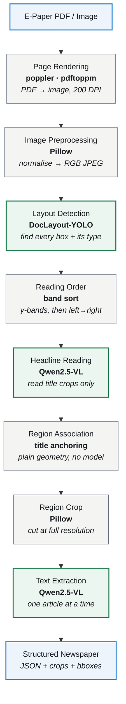
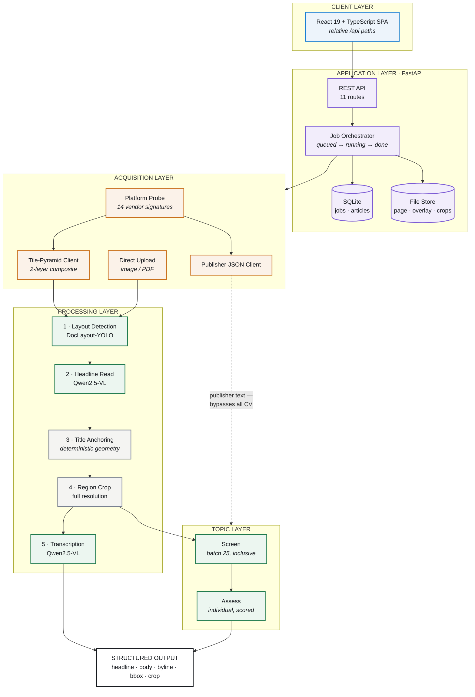
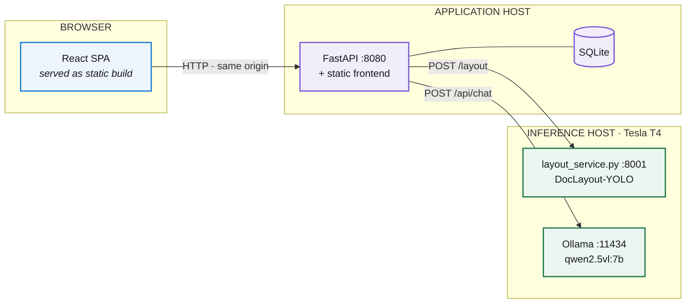
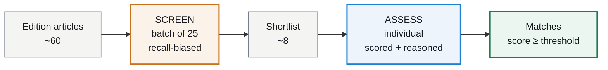

# Architecture

E-Paper article extraction — layered document-object-detection pipeline.

**Governing principle: solve the geometry before reading a word.** Layout detection finds
*parts*, a deterministic rule assembles them into *stories*, and only then does a model
read one finished story at a time. The detector is never asked to understand the page,
and the language model is never asked which text belongs to which headline.

|                       |                                          |
| --------------------- | ---------------------------------------- |
| **Layout**      | DocLayout-YOLO (YOLOv10, DocStructBench) |
| **Reading**     | Qwen2.5-VL 7B via Ollama                 |
| **Association** | Deterministic geometry — no model       |
| **API**         | FastAPI (Python 3.9)                     |
| **UI**          | React 19 + TypeScript, Vite              |
| **Store**       | SQLite + filesystem                      |
| **Compute**     | Tesla T4                                 |

---

## 0. The flow at a glance



**Green = a model runs. Grey = ordinary code.**

Two things distinguish this from the usual layout-plus-OCR design:

- **OCR does not run in parallel with layout detection.** It runs *after* association, on
  one finished article at a time. Reading the whole page up front is what produces
  interleaved columns and mismatched headlines.
- **Association is not a model.** It is geometry — which makes it deterministic and
  debuggable.

---

## 1. System architecture

```
┌──────────────────────────────────────────────────────────────────────┐
│  CLIENT LAYER                                                        │
│    React 19 + TypeScript SPA                                         │
│    relative /api paths — no API host configured anywhere              │
└───────────────────────────────┬──────────────────────────────────────┘
                                │  HTTP, same origin
┌───────────────────────────────▼──────────────────────────────────────┐
│  APPLICATION LAYER · FastAPI                                         │
│                                                                      │
│    REST API (11 routes) ──► Job Orchestrator ──► SQLite  jobs        │
│                                    │                     articles     │
│                                    └──────────► File Store           │
│                                                  page · overlay      │
│                                                  crops · regions     │
└───────────────────────────────┬──────────────────────────────────────┘
                                │
┌───────────────────────────────▼──────────────────────────────────────┐
│  ACQUISITION LAYER                                                   │
│                                                                      │
│    Platform Probe  ──┬──► Publisher-JSON Client ─────────────┐       │
│    14 signatures     │       exact CMS text                  │       │
│                      │                                       │       │
│                      └──► Tile-Pyramid Client                │       │
│                              two-layer composite             │       │
│                                                              │       │
│                           Direct Upload (image / PDF)        │       │
└───────────────────────────────┬──────────────────────────────┼───────┘
                                │                              │
┌───────────────────────────────▼──────────────────────────────┼───────┐
│  PROCESSING LAYER                                            │       │
│                                                              │       │
│    1 · Layout Detection      DocLayout-YOLO         [GPU]    │       │
│              │                                               │       │
│    2 · Headline Read         Qwen2.5-VL             [GPU]    │       │
│              │                                               │       │
│    3 · Title Anchoring       deterministic geometry [CPU]    │       │
│              │                                               │       │
│    4 · Region Crop           full resolution        [CPU]    │       │
│              │                                               │       │
│    5 · Transcription         Qwen2.5-VL             [GPU]    │       │
└──────────────┬───────────────────────────────────────────────┼───────┘
               │                                               │
               │            ┌──────────────────────────────────┘
               │            │  bypasses the entire vision pipeline
┌──────────────┼────────────▼─────────────────────────────────────────┐
│  TOPIC LAYER │                                                      │
│              │      Screen  (batch of 25, recall-biased)            │
│              │         │                                            │
│              │      Assess  (individual, scored + reasoned)         │
└──────────────┼────────────┬─────────────────────────────────────────┘
               │            │
┌──────────────▼────────────▼─────────────────────────────────────────┐
│  STRUCTURED OUTPUT                                                  │
│    headline · body · byline · dateline · category · bbox · crop     │
└─────────────────────────────────────────────────────────────────────┘
```

Same diagram, rendered:



> **The design decision that matters.** Stage 3 is **not a model**. Article association is
> solved with geometry, not inference — deterministic, instant, and inspectable when it
> is wrong. An earlier version asked the VLM to group regions; it merged 66 elements into
> a single "article" covering most of a page.

---

## 2. Deployment topology

```
   BROWSER                APPLICATION HOST              INFERENCE HOST · Tesla T4
                                                      
  ┌──────────┐          ┌──────────────────┐          ┌─────────────────────────┐
  │  React   │  HTTP    │  FastAPI :8080   │  POST    │  layout_service.py :8001│
  │   SPA    │ ───────► │  + static build  │ ───────► │  DocLayout-YOLO         │
  │          │  /api/*  │                  │ /layout  │                         │
  └──────────┘  same    │        │         │          ├─────────────────────────┤
                origin  │        ▼         │  POST    │  Ollama :11434          │
                        │  ┌──────────┐    │ ───────► │  qwen2.5vl:7b           │
                        │  │  SQLite  │    │ /api/chat│                         │
                        │  └──────────┘    │          └─────────────────────────┘
                        └──────────────────┘
                                              SSH port-forward
                                              (never publicly exposed)
```



**The inference host holds no application code.** Image in, bounding boxes out. It has no
concept of a newspaper, a job or an article.

| Concern          | Mechanism                                                                                                  |
| ---------------- | ---------------------------------------------------------------------------------------------------------- |
| Frontend → API  | Same-origin relative paths. The SPA build is served by FastAPI itself — no API host to configure, no CORS |
| API → inference | Plain HTTP POST over stdlib`urllib`. No SDK, no RPC framework                                            |
| Transport        | SSH port-forward; inference ports are never publicly exposed                                               |
| Mode switch      | `EPAPER_LAYOUT_URL` set = remote inference, unset = in-process. No code change                           |
| Concurrency      | Background tasks on the API process —**no queue yet**                                               |

---

## 3. Processing stages

| # | Stage            | In → Out                    | Technology                                   | Runs on       |
| - | ---------------- | ---------------------------- | -------------------------------------------- | ------------- |
| 0 | Acquisition      | source →`page.jpg`        | Tile compositing / HTTP / poppler            | CPU           |
| 1 | Layout detection | page → labelled boxes       | DocLayout-YOLO,`imgsz 1024`, `conf 0.20` | **GPU** |
| 2 | Headline read    | title crops → headline text | Qwen2.5-VL 7B                                | **GPU** |
| 3 | Title anchoring  | boxes → article groups      | **Deterministic geometry**             | CPU           |
| 4 | Region crop      | groups → article images     | Pillow, full resolution                      | CPU           |
| 5 | Transcription    | crop → structured fields    | Qwen2.5-VL 7B                                | **GPU** |
| 6 | Persistence      | fields → rows + files       | SQLite + filesystem                          | CPU           |

### Reading order

Banded: sort by `y0 // 60`, then by `x0` — top-to-bottom in horizontal bands, left-to-right
within each band. Class `abandon` (running heads, folios) and boxes under 8px are dropped.

### Article association

Every non-title region is assigned to the nearest title above it that covers it
horizontally, subject to three constraints:

- horizontal overlap ≥ **25%** of the narrower box
- the title is above — tolerating slight inversion for headline-beside-standfirst
- vertical gap ≤ **28%** of page height

Score is `overlap − normalised distance`; the nearest covering title wins. Title
candidates below `max(H × 0.008, 0.50 × median)` are demoted, because the detector labels
bylines and section tags as titles. Unassigned regions are retained as **orphans** rather
than discarded — a dropped region is a lost story.

```
        ┌──────────────────────────────────────────────────┐
        │        MASTHEAD                                  │
        ├───────────────────────┬──────────────────────────┤
        │  HEADLINE A           │  HEADLINE B              │
        │  ┌─────────────────┐  │  ┌────────────────────┐  │
        │  │ body            │  │  │ body               │  │
        │  └─────────────────┘  │  └────────────────────┘  │
        │  ┌─────────────────┐  │  ┌────────────────────┐  │
        │  │ body            │  │  │  figure            │  │
        │  └─────────────────┘  │  └────────────────────┘  │
        └───────────────────────┴──────────────────────────┘

   Left blocks   → HEADLINE A is above AND overlaps horizontally
   Right blocks  → HEADLINE B  (A is above, but does not overlap)
```

> **Failure policy.** Any stage failure raises and marks the job errored. There is **no
> silent fallback** to the cruder geometric detector — an earlier fallback produced 697
> plausible-looking but unusable clippings that went unnoticed.

---

## 4. Topic retrieval



~10 model calls instead of 60.

Stage one is deliberately biased toward **recall**: a story dropped here is unrecoverable,
while a false positive costs one assess call. On any error the whole batch is kept. Stage
two supplies **precision**, and is instructed that incidental mention of a topic does not
make a story about it.

> **Known architectural gap.** Stage one currently uses the LLM. It should be a **lexical +
> vector prefilter** — query expansion (`police → FIR, constable, DSP, arrest`), BM25,
> embedding similarity — with the LLM reserved for stage two. That removes the dominant
> cost and the dependency on GPU availability.

---

## 5. Design rationale

| Decision                      | Rationale                                                                                                                       |
| ----------------------------- | ------------------------------------------------------------------------------------------------------------------------------- |
| Layout before OCR             | Reading a broadsheet linearly interleaves columns; downstream splitting then fails*silently*. Geometry must be resolved first |
| Geometry for association      | Deterministic and inspectable. An LLM asked to group side-by-side stories collapses them                                        |
| VLM over classical OCR        | Returns labelled fields rather than a character stream.*Trade-off: weak on Indic scripts*                                     |
| Crop at full resolution       | Indian broadsheet body text is ~7pt; sub-2000px page width destroys legibility irrecoverably                                    |
| Publisher JSON when available | Exact CMS text, zero error surface, no compute                                                                                  |
| Self-hosted models            | No per-page API cost; data does not leave controlled infrastructure                                                             |
| Same-origin SPA               | Deployment portability — no environment-specific API host, no CORS                                                             |
| Fail loudly                   | Silent degradation produced a large volume of undetected bad output                                                             |

---

## 6. Roadmap

| Priority | Change                                                            | Addresses                                                       |
| -------- | ----------------------------------------------------------------- | --------------------------------------------------------------- |
| 1        | PaddleOCR for Indic scripts, retaining layout-derived field roles | Telugu unreadable; Gujarati unverified — blocks a target state |
| 2        | Lexical + vector prefilter ahead of LLM assess                    | Topic search latency and GPU contention                         |
| 3        | Supervised process management for inference service + tunnel      | Manual startup; no restart on failure                           |
| 4        | Fine-tune detector with`advertisement` and `byline` classes   | Bylines misclassified as titles; adverts inferred heuristically |
| 5        | Platform branch in the page-fetch path                            | Publisher-JSON papers unavailable in page extraction            |

---

## Validation status

Verified on English and Hindi editions at 99% region coverage. Region coverage measures
**segmentation**, not reading accuracy — the latter has not been measured on a
statistically meaningful sample, and there is no automated test suite.

See also: [HOW-IT-WORKS.md](HOW-IT-WORKS.md) for a plain-language explanation,
[FUNCTIONALITY.md](FUNCTIONALITY.md) for the detailed reference, and
[DEPLOYMENT.md](DEPLOYMENT.md) for the runbook.
