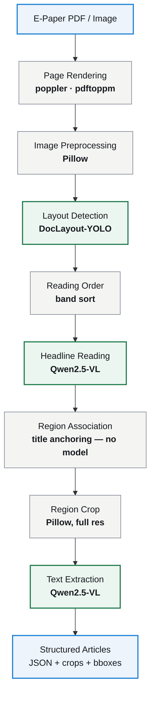
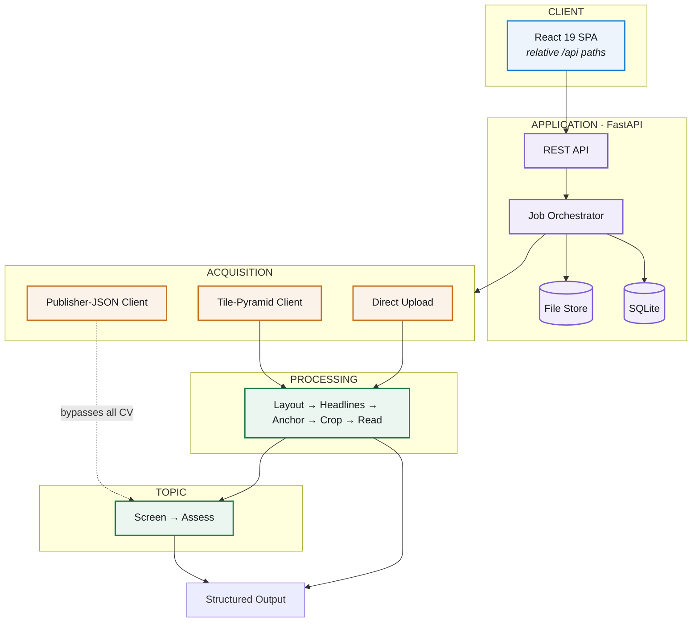
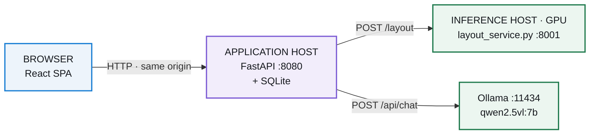
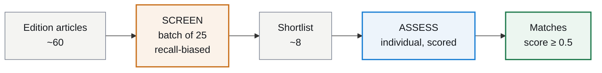

# E-Paper Article Extraction — Complete Guide

**One document, end to end.** What this project is, why it is built this way, every
component, how to run it from nothing, what works, what does not, and what to do next.

Written to be self-contained. If you are a person joining the project or an agent picking
up the work, everything you need is here. No prior context assumed.

---

## Contents

1. [What this is](#1-what-this-is)
2. [The problem, and why the obvious solution fails](#2-the-problem-and-why-the-obvious-solution-fails)
3. [The approach](#3-the-approach)
4. [Architecture](#4-architecture)
5. [Repository map](#5-repository-map)
6. [The three flows](#6-the-three-flows)
7. [Core algorithms](#7-core-algorithms)
8. [Acquisition — getting pages in the first place](#8-acquisition--getting-pages-in-the-first-place)
9. [Tech stack and dependencies](#9-tech-stack-and-dependencies)
10. [Environment variables](#10-environment-variables)
11. [Running it locally, from zero](#11-running-it-locally-from-zero)
12. [Running split, with a GPU server](#12-running-split-with-a-gpu-server)
13. [API reference](#13-api-reference)
14. [Data model](#14-data-model)
15. [CLI tools](#15-cli-tools)
16. [Current deployment state](#16-current-deployment-state)
17. [What works, honestly](#17-what-works-honestly)
18. [Known bugs and traps](#18-known-bugs-and-traps)
19. [Roadmap](#19-roadmap)
20. [Troubleshooting](#20-troubleshooting)

---

## 1. What this is

A system that takes a **newspaper page** — as an image or PDF — and returns the
**individual articles** on it, each with its headline, body text, byline, photo and
pixel coordinates.

It ships with a web UI where you can upload a page or pick a newspaper and date, watch
the extraction run, and browse the results and history. There is also a topic search: ask
for "police related news" and get back only the stories about policing from a whole
edition.

**Target scope:** Delhi and Gujarat state newspapers. English and Hindi work today;
Telugu does not; Gujarati is untested.

---

## 2. The problem, and why the obvious solution fails

To a computer a newspaper page is one flat grid of pixels. It does not know there are
eight stories on it, where one ends and the next begins, or which words are a headline.

**The obvious approach — OCR the page, then ask an LLM to split the text into stories —
does not work.** Understanding why is the single most important thing in this document.

A newspaper prints in columns. OCR engines read a page broadly left-to-right, the way you
read a book. On a broadsheet that yields: first line of Story A, first line of Story B,
first line of Story C, back to second line of Story A. The text arrives **interleaved**.

Hand that to a language model and ask it to sort out which sentence belongs where and it
cannot — but it will not say so. It guesses, confidently. You get output that looks
perfectly clean until you read it and find the headline says "Minister Resigns" over a
body about a cricket match.

**And templates do not save you.** Newspapers redesign their front page daily. Today's
layout is not tomorrow's.

---

## 3. The approach

The order is inverted:

> **Instead of:** read everything → then infer the structure
> **We do:** determine the structure → then read

The intuition: imagine a newspaper page in a script you cannot read at all. Could you
still point and say "that is one story, that is another"? Yes — you would look at the
large bold text and see which blocks of small text sit beneath it. **Structure is
visible without literacy.**

So the system resolves geometry first, purely from where things sit on the page. Only
once it knows "these four blocks belong to that headline" does it cut out that one story
and ask a model to read it.

**The model is never asked which text goes with which headline.** That is settled before
it sees anything. It is only asked "what does this say" — a much easier question.

There is also a fast lane. Some publishers serve their articles as JSON on their own
site — the real text, already separated. When that exists we take it and skip the entire
vision pipeline.

---

## 4. Architecture

### The flow at a glance



Green = a model runs. Grey = ordinary deterministic code.

**Note what is *not* here:** OCR does not run in parallel with layout detection. It runs
*after* association, on one finished article at a time. That single ordering choice is
what prevents mismatched headlines.

### Layered view



### Where things run



Three key properties:

- **The frontend contains no server address.** Every call is a relative path. The built
  SPA is served by FastAPI itself, so it talks to whoever served it — works on localhost,
  behind nginx, on any domain, with no rebuild and no CORS.
- **The inference host holds no application code.** Image in, bounding boxes out. It has
  no concept of a newspaper, a job or an article.
- **Remote vs local inference is one environment variable.** No code change.

---

## 5. Repository map

```
E-Paper-Collection/
├── epaper/                     the pipeline package
│   ├── probe.py                fingerprint a publisher host, decide strategy
│   ├── platforms/
│   │   ├── summit.py           publisher-JSON client  (article text, no OCR)
│   │   └── readwhere.py        tile-pyramid client    (page images)
│   ├── acquire.py              turn either source into one full-res page.jpg
│   ├── local_backend.py        ★ THE CORE — detect, group, transcribe
│   ├── vlm.py                  model abstraction (Ollama / vLLM)
│   ├── topics.py               two-stage topic filter
│   ├── segment.py              legacy Claude path; supplies crop_region()
│   ├── autosegment.py          model-free geometric fallback (unused by the app)
│   └── store.py                MongoDB persistence for the CLI tools
│
├── web/
│   ├── app.py                  ★ FastAPI app, SQLite, job orchestration
│   ├── frontend/               React 19 + TypeScript + Vite
│   │   ├── src/api.ts          every backend call (all relative paths)
│   │   ├── src/hooks/          useJobPoll, useHealth, useCatalogue
│   │   ├── src/views/          NewExtraction, TopicSearch, Result, History
│   │   ├── src/components/     Dropzone, ClipCard, ProgressPanel, ZoomModal…
│   │   └── dist/               built output — served by app.py (gitignored)
│   └── data/                   SQLite + per-job files (gitignored)
│
├── server/
│   └── layout_service.py       runs ON the GPU box — YOLO over HTTP
│
├── scripts/                    CLI batch tools
│   ├── discover.py             probe every paper in a region
│   ├── fetch_delhi.py          download pages → disk + MongoDB
│   ├── health.py               check every prerequisite
│   ├── segment_page.py         segment one page
│   ├── build_all_pdfs.py       batch → PDF per paper
│   └── build_report.py / build_page.py / build_pdfs.py
│
├── data/
│   ├── delhi_papers.json       35 candidate papers
│   └── gujarat_papers.json     22 candidate papers
│
├── docs/                       ← you are here
├── out/                        extraction output (gitignored, ~560 MB)
└── requirements.txt            INCOMPLETE — see §9
```

**If you read only one file, read `epaper/local_backend.py`.** It is the core.

---

## 6. The three flows

### Flow A — upload a page

| # | Step | Where | Stage label |
|---|---|---|---|
| 1 | File posted as multipart | browser | |
| 2 | Job row inserted, **request returns immediately** | app | `queued` |
| 3 | Browser polls `/api/jobs/{id}` every 1.5 s | browser | |
| 4 | PDF → image via `pdftoppm` (first page only), or Pillow → RGB JPEG | app | `acquiring` |
| 5 | Layout detection | **GPU** | `detecting layout` |
| 6 | Read every candidate headline | **GPU** | `detecting layout` |
| 7 | Title anchoring | app | `detecting layout` |
| 8 | Draw `overlay.jpg`, crop each region at full res | app | `cropping` |
| 9 | Transcribe each article *(only if `with_text`)* | **GPU** | `reading text 3/11` |
| 10 | Write article rows + `regions.json` | app | |
| 11 | Job `done`; UI renders | browser | `complete` |

> **Trap:** the stage label is set once before step 5 and never updated through 5–7. A
> job busy reading headlines still reports `detecting layout`, which makes slow jobs look
> frozen. Fixing this is a small, worthwhile change.

If any step raises, the job is marked `error` with the message stored. **There is no
silent fallback** — see §7.

### Flow B — fetch from the catalogue

Identical to Flow A from step 4 onward. Only acquisition differs: the page is downloaded
and stitched from the publisher instead of uploaded. See §8.

> **Gap:** this path is **Readwhere-only**. It constructs a Readwhere client
> unconditionally with no platform branch, so choosing a publisher-JSON paper (Sakshi,
> Namasthe Telangana) and pressing Extract fails with "no issue published". Those papers
> work in Topic search only.

### Flow C — topic search



1. **Collect.** Publisher-JSON papers yield article text directly — no images, no GPU,
   very fast. Image papers require fetching and segmenting each page first (slow). If a
   publisher-JSON edition turns out to be untagged, it falls back to page images.
2. **Screen.** 25 story openings per call, answering only "could this plausibly be about
   the topic?" **Deliberately over-inclusive** — a story dropped here is unrecoverable,
   one wrongly kept costs a single call. On error the whole batch is kept.
3. **Assess.** Survivors go one at a time for a scored judgement with reasons. The prompt
   forbids rewarding keyword overlap.
4. **Rank** by score, keep those above threshold.

~10 model calls instead of 60.

---

## 7. Core algorithms

### Reading order

Sort elements by `(y0 // 60, x0)` — horizontal bands of 60 px top-to-bottom, then
left-to-right within each band. Class `abandon` (running heads, folios) and boxes under
8 px in either dimension are discarded first.

### Title anchoring — the heart of the system

Every non-title region is assigned to **the nearest title above it that covers it
horizontally**, subject to three constraints:

| Constraint | Value | Why |
|---|---|---|
| Horizontal overlap | ≥ 25% of the narrower box | A left-column headline does not own a right-column paragraph |
| Vertical position | `dy ≥ −0.25 × block height` | Title must be above, tolerating headline-beside-standfirst |
| Vertical reach | `dy ≤ 0.28 × page height` | A story does not run half a page below its own headline |

Score is `overlap × 100 − (dy / H) × 100`; the nearest covering title wins.

```
        ┌──────────────────────────────────────────────────┐
        │        MASTHEAD                                  │
        ├───────────────────────┬──────────────────────────┤
        │  HEADLINE A           │  HEADLINE B              │
        │  ┌─────────────────┐  │  ┌────────────────────┐  │
        │  │ body            │  │  │ body               │  │
        │  └─────────────────┘  │  └────────────────────┘  │
        │  ┌─────────────────┐  │  ┌────────────────────┐  │
        │  │ body            │  │  │  figure            │  │
        │  └─────────────────┘  │  └────────────────────┘  │
        └───────────────────────┴──────────────────────────┘

   Left blocks   → HEADLINE A   (above AND overlapping)
   Right blocks  → HEADLINE B   (A is above, but does not overlap)
```

**Why not ask a model to group?** We tried. A horizontal strip of a broadsheet holds
several unrelated stories side by side; asked to "group these regions", a 7B model lumped
them under whichever headline it noticed first — producing one 66-element "article"
covering most of the page. Geometry is deterministic, instant and inspectable.

**Height floor.** The detector labels bylines and section tags ("SPORTS", "STATESMAN NEWS
SERVICE") as titles. Candidates below `max(H × 0.008, 0.50 × median_candidate_height)`
are demoted to ordinary blocks — one such byline had anchored a 1279×1951 group.

**Orphans are kept.** A region matching no headline is emitted with `unassigned: true`
rather than dropped. A missing region is a lost story.

### The no-fallback rule

If any stage fails, the backend **raises**. It never quietly degrades to the crude
geometric detector.

This is not defensive coding — it is a scar. An earlier silent fallback produced **697
clippings** that looked entirely plausible in a list and were almost all unusable when
opened. Nobody noticed for a long time. A loud failure you can see beats a quiet failure
you cannot.

---

## 8. Acquisition — getting pages in the first place

`epaper/probe.py` fingerprints a publisher host against 14 vendor signatures and returns
one of four verdicts:

| Verdict | Meaning | Action |
|---|---|---|
| `api` | A probed endpoint returned usable JSON | Take publisher text, skip CV |
| `known-platform` | Vendor identified, blind probe missed | A client may be writable |
| `cv` | No data source found | Page images + full pipeline |
| `unreachable` | Dead / blocking / DNS failure | Nothing can run |

### Publisher-JSON platform (`summit.py`)

The publisher's own DTP article text. No OCR, no layout analysis. Verified on
`epaper.ntnews.com` and `epaper.sakshi.com`.

- **Tagging is per-edition, not per-title.** On Namasthe Telangana the two main editions
  are fully tagged (120 articles / 12 pages) while every district edition returns an
  empty story list and needs CV.
- **Dates must be `DD/MM/YYYY`.** `YYYY-MM-DD` silently returns an empty list.
- **Telugu headline trap:** headlines are legacy non-Unicode font bytes; the **body is
  proper Unicode**. Only headlines need a mapping table.

### Tile-pyramid platform (`readwhere.py`)

Financial Express, The Statesman, The Tribune, Jansatta, Dainik Tribune. No login needed
for what is implemented. Provides **no** article segmentation — its `clips` are user-made
and come back empty.

Pages are served as a grid of tiles. We request every tile and composite them.

> ### ⚠ The two-layer trap
>
> **Each tile position carries two files**, not one:
>
> - an opaque **`.jpg`** background — photographs and display advertising
> - a transparent **`.png`** overlay — **all editorial text**
>
> Composite only the JPEG and you get a page with pictures and no words. It looks exactly
> like a paywall. It is not — you dropped half the data. Both layers must be stacked,
> base first, text alpha-composited on top.
>
> This cost days to diagnose. Do not undo it.

**Resolution rule.** Indian broadsheet body text is ~7pt. Below roughly 2000 px page
width, reading quality collapses regardless of engine. Always take the largest level.

**Known limit:** paid titles serve page 1 free; pages 2+ need subscription parameters
(`?user=&crypt=&key=`) that no module passes. Free full editions confirmed: FE 54 pages,
Jansatta 44, Statesman 12.

---

## 9. Tech stack and dependencies

| Layer | Technology | Note |
|---|---|---|
| Frontend | React 19, TypeScript, Vite 8 | Built to static files, served by the backend |
| API | FastAPI 0.111, Python 3.9 | Single module |
| Job store | SQLite | One file, no daemon |
| Layout | DocLayout-YOLO (YOLOv10, DocStructBench) | Off-the-shelf checkpoint, no training done |
| Reading | Qwen2.5-VL 7B via Ollama | Returns labelled fields, not a character stream |
| Grouping | Plain Python | Deliberately not a model |
| Images | Pillow 11.3 | Tiles, crops, overlays, PDFs |
| Archive | MongoDB | CLI tools only — **the web app does not use it** |
| HTTP client | stdlib `urllib` | No requests, no httpx, no SDKs |

### ⚠ `requirements.txt` is incomplete

It declares only `Pillow>=9.0` and `pymongo>=4.0`. **The app will not start from it.**
The real set:

```bash
# web app — undeclared but required
pip3 install fastapi uvicorn python-multipart

# declared
pip3 install -r requirements.txt

# layout stage (GPU box, or locally for in-process mode) — undeclared but required
pip3 install torch --index-url https://download.pytorch.org/whl/cu121
pip3 install doclayout-yolo
```

No lockfile, no pins, no checksums. Fixing this is a genuine to-do.

### System dependencies

| Dependency | Needed by | Install |
|---|---|---|
| Ollama + `qwen2.5vl:7b` | anything reading text | `ollama pull qwen2.5vl:7b` (~6 GB) |
| DocLayout-YOLO checkpoint | layout stage | `~/models/doclayout_yolo_docstructbench_imgsz1024.pt` — **fetched out of band; nothing in the repo downloads it** |
| CUDA GPU | layout stage | CPU/MPS works but is slow |
| poppler (`pdftoppm`) | PDF uploads only | `brew install poppler` |
| MongoDB | `scripts/` tools only | Not needed by the web app |

---

## 10. Environment variables

Twelve exist. The stale README documents four.

| Variable | Default | Effect |
|---|---|---|
| `EPAPER_LAYOUT_URL` | *unset* | **The local/remote switch.** Unset = in-process YOLO; set = POST to a remote layout service |
| `EPAPER_YOLO` | `~/models/doclayout_yolo_docstructbench_imgsz1024.pt` | Checkpoint path |
| `EPAPER_DEVICE` | `cuda:0` | Torch device |
| `EPAPER_DEBUG_DIR` | `out/debug` *(relative!)* | Debug artefacts. **Pin absolute under a supervisor** |
| `EPAPER_VLM_BACKEND` | `ollama` | `ollama` \| `vllm`; anything else raises |
| `EPAPER_VLM` | `qwen2.5vl:7b` | Vision model tag |
| `EPAPER_TEXT_MODEL` | falls back to `EPAPER_VLM` | Topic screening model. **Leave unset** — a T4 holds one 7B model, not two |
| `EPAPER_NUM_CTX` | `16384` | **Do not lower.** Ollama's own default is 4096 and it truncates a full-page image *silently* |
| `EPAPER_OLLAMA` | `http://localhost:11434` | Ollama endpoint |
| `EPAPER_VLLM` | `http://localhost:8000/v1` | Future — vLLM is blocked by an NVML driver mismatch |
| `EPAPER_MODEL` | `claude-opus-5` | Legacy Claude path only |
| `ANTHROPIC_API_KEY` | *none* | Legacy path only; read lazily |

There is no `.env` or `.env.example`. A supervisor-launched process inherits **none** of
these and silently falls back to `cuda:0` + localhost Ollama.

---

## 11. Running it locally, from zero

Assumes a fresh clone and nothing installed.

### Step 1 — Python dependencies

```bash
cd E-Paper-Collection
pip3 install fastapi uvicorn python-multipart
pip3 install -r requirements.txt
```

### Step 2 — the layout model

```bash
pip3 install torch doclayout-yolo
mkdir -p ~/models
# download doclayout_yolo_docstructbench_imgsz1024.pt into ~/models/
# (from the DocLayout-YOLO release / HuggingFace — nothing in this repo fetches it)
```

### Step 3 — the reading model

```bash
# install Ollama first: https://ollama.com
ollama pull qwen2.5vl:7b        # ~6 GB
```

### Step 4 — optional extras

```bash
brew install poppler            # only if you want PDF uploads
brew install mongodb-community  # only if you want the scripts/ batch tools
```

### Step 5 — build the frontend

```bash
cd web/frontend
npm ci
npm run build                   # produces dist/, which app.py serves
cd ../..
```

### Step 6 — configure and check

```bash
export EPAPER_YOLO=~/models/doclayout_yolo_docstructbench_imgsz1024.pt
export EPAPER_VLM_BACKEND=ollama
export EPAPER_VLM=qwen2.5vl:7b
export EPAPER_NUM_CTX=16384

python3 scripts/health.py --probe
```

`health.py` exits 0 only when everything is ready. It checks the weights, the
`doclayout_yolo` import, CUDA, torch, VLM reachability, context window, and Mongo. With
`--probe` it draws a synthetic image reading "MINISTER RESIGNS", sends it to the model,
and passes only if the returned headline contains MINISTER or RESIGN. **That is the one
end-to-end smoke test in the repo.**

### Step 7 — run

```bash
python3 web/app.py --port 8080
# → http://127.0.0.1:8080
```

> ### ⚠ Launch it as a script, not through uvicorn
>
> `init_db()` runs **only** inside `main()`. Serving via `uvicorn web.app:app`, gunicorn,
> or any supervisor that imports the module gives a database with **no tables** and every
> endpoint 500s. Either always use `python3 web/app.py`, or add a startup hook.

### Verify

```bash
curl -s localhost:8080/api/health | python3 -m json.tool
# want: "ready": true
```

---

## 12. Running split, with a GPU server

The application stays on your machine; only inference moves.

### On the GPU box

```bash
~/epaper-venv/bin/python server/layout_service.py --port 8001 --preload
```

Serves `POST /layout` (`{image_b64, conf}` → `{elements, size, ms}`) and `GET /health`.
`--host` defaults to `127.0.0.1`, so use a tunnel rather than exposing it.

### On your machine

```bash
ssh -N -L 8001:localhost:8001 -L 11500:localhost:11434 user@gpubox

export EPAPER_LAYOUT_URL=http://localhost:8001
export EPAPER_OLLAMA=http://localhost:11500
```

Then restart the app. `/api/health` should report `"mode": "remote"`.

> ### Both tunnels are required — this is the step everyone misses
>
> Even in remote-layout mode, **every VLM call still goes to `EPAPER_OLLAMA`**, which
> defaults to *your own* localhost. Setting only `EPAPER_LAYOUT_URL` moves layout to the
> GPU while text reading silently tries your local machine.
>
> Port 11500 rather than 11434 because a Mac running its own Ollama would collide.

**How the tunnel works:** `ssh -L 8001:localhost:8001` opens port 8001 *on your machine*
and forwards anything sent there to port 8001 on the GPU box. Python believes it is
calling a local service. Proof: a Mac with no NVIDIA hardware, asked
`curl localhost:8001/health`, answers `Tesla T4, cuda: true`.

> ### ⚠ Health reporting is not trustworthy
>
> The layout service sets `ok = weights_present` **alone** — it returns `ok: true` on a
> box with no CUDA, no torch and no model loaded. Remote mode then copies that into the
> web app's `ready`. **Gate on `cuda` and `model_loaded`, never on `ok` or `ready`.**

---

## 13. API reference

| Method | Route | Purpose |
|---|---|---|
| GET | `/` | The React SPA |
| GET | `/api/health` | `{ready, gpu, layout, mode, vlm, vlm_ok, detail}` |
| GET | `/api/papers` | Catalogue: `[{name, host, lang, platform}]` (7 entries) |
| GET | `/api/editions?host=` | Editions/titles. **Memoised forever** — new editions need a restart |
| GET | `/api/dates?host=&title_id=` | Readwhere: real publish dates, 60 back. Publisher-JSON: 30 **synthetic** days, unverified |
| POST | `/api/jobs/upload` | multipart `file` + `with_text` → `{job_id}` |
| POST | `/api/jobs/fetch` | `{host, title_id, date, page_no, edition, with_text}` → `{job_id}` |
| POST | `/api/jobs/topic` | `{host, title_id, date, topic, edition, max_pages, min_score}` |
| GET | `/api/jobs?limit=60` | History rows |
| GET | `/api/jobs/{id}` | `{job, articles[]}` — the polling endpoint |
| DELETE | `/api/jobs/{id}` | Remove rows + job directory. **Does not cancel a running job** |
| GET | `/api/media/{id}/{name}` | Serve crops and overlays |

FastAPI also auto-exposes `/docs`, `/redoc`, `/openapi.json`.

> ### 🔴 SECURITY — fix before any non-loopback bind
>
> `/api/media/{jid}/{name}` validates `name` but **not `jid`**. A percent-encoded
> traversal returns the database:
>
> ```
> GET /api/media/%2e%2e/jobs.db   →  200 OK, the entire SQLite file
> ```
>
> Verified live. The fix:
>
> ```python
> if not re.fullmatch(r"[0-9a-f]{12}", jid):   # ids are uuid4().hex[:12]
>     raise HTTPException(400, "bad job id")
> ```
>
> There is also **no auth, rate limiting, CSRF protection or upload size limit** on any
> route, and `Image.MAX_IMAGE_PIXELS = None` removes the decompression-bomb guard on an
> unauthenticated upload path. Put a reverse proxy with auth in front before exposing it.

---

## 14. Data model

### SQLite — `web/data/jobs.db`

**`jobs`** (21 columns): `id, created, source, paper, edition, date, page_no, status,
stage, error, n_articles, n_ads, coverage, width, height, with_text, elapsed, kind,
topic, searched, screened`

**`articles`** (16 columns): `job_id, seq, type, headline, body, byline, dateline,
category, bbox, crop, n_elements, has_photo, topic_score, topic_why, topic_summary,
page_ref`

Schema upgrades in place via best-effort `ALTER TABLE ADD COLUMN`. No index on
`job_id`, no foreign keys.

### Files — `web/data/jobs/<job_id>/`

| File | Contents |
|---|---|
| `page.jpg` | Normalised full page |
| `overlay.jpg` | Annotated preview — article blue, advert orange, masthead grey |
| `a01.jpg`… | Each article cut at full resolution |
| `regions.json` | Raw detector output — every element, every score |

### Quality field

`text_source` is what to trust:

- `publisher` — exact CMS text, no OCR anywhere
- `vlm` / `vlm-local` — read off the image by a model
- `layout-only` — boundaries known, text not extracted

Also emitted: `coverage` (fraction of detected elements assigned to an article),
`grouping_confidence` per article.

---

## 15. CLI tools

| Script | Invocation | Produces |
|---|---|---|
| `discover.py` | `python3 scripts/discover.py [delhi\|gujarat] [filter…]` | `out/<region>_probe.json` + verdict table |
| `fetch_delhi.py` | `python3 scripts/fetch_delhi.py [--date] [--paper] [--max-pages]` | `out/pages/<Paper>/<Edition>/<date>/pNN.jpg` + Mongo rows |
| `health.py` | `python3 scripts/health.py [--probe]` | Prerequisite checklist; exit 0 when ready |
| `segment_page.py` | `python3 scripts/segment_page.py --page PATH` | Crops + JSON report |
| `build_all_pdfs.py` | `python3 scripts/build_all_pdfs.py --backend local` | `out/pdf/<Paper> <date>.pdf` |

> **Fresh-clone traps.** `build_page.py` reads `out/coverage.json`, which **nothing in the
> repo produces** — it is hand-authored. `build_report.py` and `build_pdfs.py` hardcode
> `out/regions_*.json` ground-truth files that no script recreates. All three fail
> immediately on a clone because `out/` is gitignored.

---

## 16. Current deployment state

```
APPLICATION HOST (Mac)
  Python 3.9.6 · FastAPI 0.111 · Pillow 11.3 · Node 23.11
  web/app.py :8080                mode=remote
  frontend build 355 KB js + 20 KB css
  ssh -N -L 8001 -L 11500         MANUALLY STARTED

INFERENCE HOST (GPU box)
  Tesla T4 · torch 2.13.0+cu130 · CUDA active
  layout_service.py :8001         model preloaded, nohup setsid
  Ollama :11434                   qwen2.5vl:7b, 5.97 GB
```

**No systemd unit, launchd plist, Dockerfile or compose file exists anywhere.** Both
servers are foreground commands. The tunnel is a backgrounded `ssh -N`. If it drops,
health flips to not-ready and jobs fail at the layout stage.

> ### ⚠ The GPU box is shared and contended
>
> Its Ollama is also used by another production project. Measured over 15 minutes:
> **408 requests from the other project, 1 from us.** Both use different 7B models on one
> 16 GB card, so Ollama evicts and reloads between requests and our jobs stall for
> minutes per headline.
>
> Layout detection is unaffected — it has a dedicated service. **Fix:** run the reading
> model locally and leave only layout on the GPU box.

---

## 17. What works, honestly

| Capability | State | Evidence |
|---|---|---|
| English pages | ✅ works | Statesman p1 — 11 regions, 8 named, 99% coverage. Tribune p1 — 8 articles + advert + masthead |
| Hindi pages | ✅ works | Jansatta p3 — 13 articles, 99% coverage, umbrella package split correctly |
| Publisher-JSON text | ✅ works | 120 articles / 12 pages, no OCR |
| Upload any image | ✅ works | Same pipeline as a fetched page |
| Topic filtering | ⚠ works, slow | Logic verified; throttled by the shared GPU |
| Page extract for JSON papers | ❌ not wired | Readwhere-only path |
| Telugu | ❌ fails | Model returns confident, wrong Telugu |
| Gujarati | ❓ untested | **The most important open question** |
| Gujarat sources | ❌ 1 of 22 | Only Ahmedabad Mirror uses a supported platform |

**On "99% coverage".** It means 99% of *detected elements* were assigned to some article
— a segmentation measure. It says **nothing** about whether the text was read correctly.
Reading accuracy has never been measured on a meaningful sample. There is **no test
suite** — 28 tracked files, zero tests.

---

## 18. Known bugs and traps

Ordered by how much damage they can do.

1. **`/api/media` path traversal** returns the database. §13. Blocker for any public bind.
2. **`init_db()` only runs from `main()`** — uvicorn-launched instances have no tables.
3. **Health checks report `ok` from weights alone** — true against a dead GPU.
4. **Byline rejection is inert.** `rejected = set()` is hardcoded. Enabling it lost
   "Tribunals Reform Bill" from Statesman p1 and dropped coverage 99% → 95%, because
   removing byline-shaped titles shifts the median that sets the height floor. **A proper
   fix computes the floor before rejection.**
5. **Stage label frozen at `detecting layout`** through three stages — slow jobs look hung.
6. **Page extraction is Readwhere-only** — no platform branch.
7. **`/api/editions` is memoised forever** — new editions need a process restart.
8. **`requirements.txt` cannot start the app.**
9. **`topics.py` docstring says `qwen2.5:7b`** — wrong; the code resolves to the vision
   tag. Never pull `qwen2.5:7b`; it doubles VRAM for no benefit.
10. **The README is stale** — it documents VLM grouping (abandoned) and claims Readwhere
    theme parsing is broken (fixed).
11. **TLS verification is globally disabled** in `probe.py`, and both platform clients
    route through it.
12. **Summit dates must be `DD/MM/YYYY`** — the other format fails silently.
13. **PDF uploads process page 1 only.**

---

## 19. Roadmap

| # | Change | Addresses |
|---|---|---|
| 1 | **PaddleOCR for Indic scripts**, keeping layout-derived field roles | Telugu unreadable, Gujarati unverified — blocks a target state |
| 2 | **Lexical + vector prefilter** ahead of the LLM assess (query expansion → BM25 + embeddings) | Topic search latency and GPU contention |
| 3 | **Supervised processes** — systemd/autossh for the inference service and tunnel | Manual startup, no restart on failure |
| 4 | Fine-tune the detector with `advertisement` and `byline` classes | Bug 4 at the root; adverts currently inferred heuristically |
| 5 | Platform branch in the page-fetch path | Bug 6 |
| 6 | Gujarat acquisition clients | 21 of 22 titles unreachable |

**Start with 1.** Whether Gujarati is readable determines whether half the stated scope is
viable at all, and everything for Gujarat depends on the answer.

On PaddleOCR specifically: do **not** replace the VLM wholesale. OCR gives characters, not
labelled fields. The right combination is *layout detector supplies the role, PaddleOCR
supplies the text* — Indic support without losing structure, and much faster than a VLM
per crop.

---

## 20. Troubleshooting

| Symptom | Cause | Fix |
|---|---|---|
| `DocLayout-YOLO weights not found` | Checkpoint missing | Download to `EPAPER_YOLO` path |
| `model 'qwen2.5vl:7b' not installed` | Not pulled | `ollama pull qwen2.5vl:7b` |
| Every endpoint 500s, `no such table` | Launched via uvicorn | Use `python3 web/app.py` |
| Job stuck at `detecting layout` for many minutes | Contended/queued Ollama, or headline reads in progress | Check `ollama ps` on the box; see §16 |
| `layout service unreachable` | Tunnel dropped | Restart `ssh -N -L …` |
| `ready: true` but jobs fail on the GPU | Health checks only weights | Check `cuda` and `model_loaded` on `:8001/health` |
| Page has pictures but no text | Only the JPEG layer composited | The PNG text layer was dropped — §8 |
| Text read as confident nonsense | Unsupported script (Telugu) | Needs a different OCR — §19 |
| `PDF upload needs poppler` | `pdftoppm` not on PATH | `brew install poppler` |
| Topic search returns 0 matches | Model cannot read that script | Same as Telugu above |
| Stories merged into one giant box | A byline anchored a group | Bug 4 — inspect `regions.json` |

### Useful commands

```bash
# full prerequisite check + live model probe
python3 scripts/health.py --probe

# is the GPU box actually healthy? (not just "ok")
curl -s localhost:8001/health | python3 -m json.tool

# what is Ollama doing right now
ssh gpubox 'ollama ps'

# watch the app
tail -f web/server.log

# inspect a job's raw detector output
python3 -m json.tool web/data/jobs/<job_id>/regions.json | head -50
```

---

## Related documents

- [ARCHITECTURE.md](ARCHITECTURE.md) — diagrams and design rationale
- [HOW-IT-WORKS.md](HOW-IT-WORKS.md) — plain-language explanation, no jargon
- [FUNCTIONALITY.md](FUNCTIONALITY.md) — detailed feature reference
- [DEPLOYMENT.md](DEPLOYMENT.md) — deployment runbook

---

## For an agent picking this up

Read in this order: **§3** (why the design is inverted), **§7** (title anchoring — the
actual intellectual content), **§18** (bugs, so you do not "fix" something that is
deliberate), then `epaper/local_backend.py`.

Three things that look like bugs but are deliberate:

- `rejected = set()` in `local_backend.py` — byline rejection is disabled *on purpose*;
  enabling it naively regresses results. Read bug 4 first.
- No fallback when a stage fails — silent degradation is what the loud failure replaced.
- Grouping uses no model — that is the design, not an unfinished TODO.

And one number to distrust: **coverage measures segmentation, not reading accuracy.**
