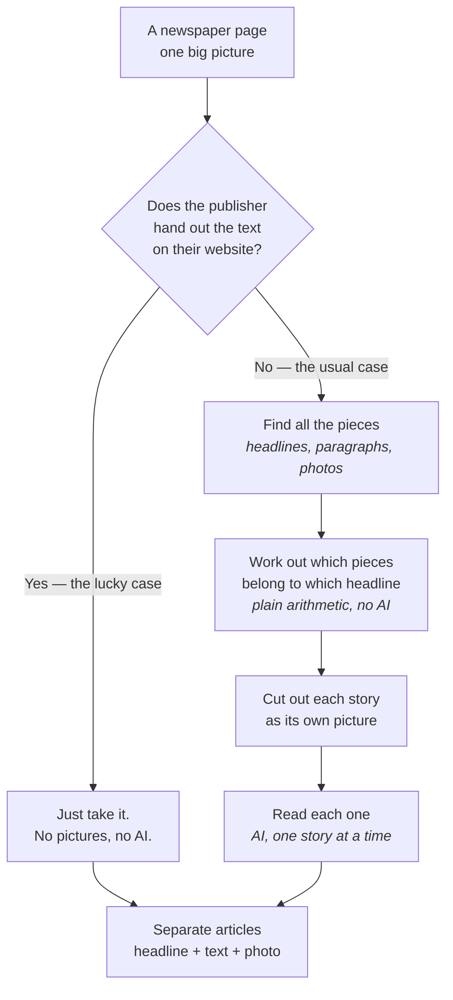
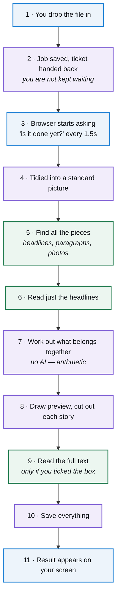
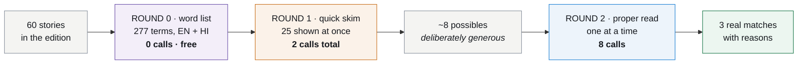
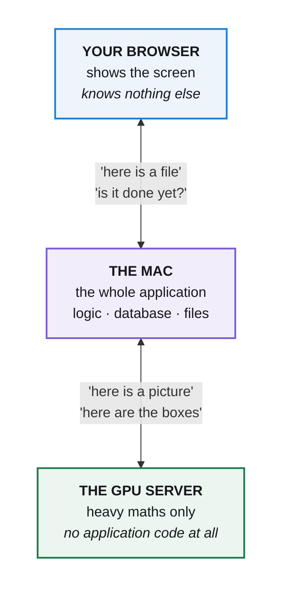

# How It Works — In Plain English

No jargon. If you have never seen this code, start here.

---

## 1. What are we actually trying to do?

You have a newspaper page. It is **one big picture**.

To a computer, that picture is just millions of coloured dots. It does not know there
are eight separate news stories on it. It does not know where one story ends and the
next begins. It does not even know which words are a headline.

We want to hand it that picture and get back:

> "Here is Story 1 — this is its headline, this is its text, this is its photo.
> Here is Story 2 — same again. Here is an advert, ignore it."

That is the whole job. **Cut one page into separate stories, correctly.**

---

## 2. Why is this hard?

The obvious idea is: *read all the text off the page, then ask an AI to split it into
stories.*

**This does not work.** Here is why.

A newspaper is printed in columns. When a computer reads text off a page, it tends to
read straight across the page — left to right — the way you would read a normal book.
But a newspaper does not work like that. Reading straight across gives you the first
line of Story A, then the first line of Story B, then the first line of Story C, then
back to the second line of Story A.

The text comes out shuffled, like a deck of cards.

Now you hand that shuffled mess to an AI and ask it to sort out which sentence belongs
to which story. It cannot. It guesses. And it guesses *confidently* — so you get a
result that looks perfectly fine until you actually read it and realise the headline
says "Minister Resigns" and the text underneath is about a cricket match.

That was the exact failure we started with.

**And you cannot fix it with a template.** You might think: "just tell the computer that
the main story is always top-left." But newspapers redesign their front page every
single day. Today's layout is not tomorrow's layout.

---

## 3. Our approach

We flipped the order around.

**Instead of: read everything → then work out the structure**
**We do: work out the structure → then read**

Think of it like this. Imagine a page of a newspaper laid out on a table, but written in
a language you cannot read at all. Could you still point at it and say "that's one
story, that's another story"?

**Yes, you could.** You would look at the big bold text, and see which blocks of small
text sit underneath it. You would notice the white gaps and the dividing lines. You do
not need to understand a single word to see the structure.

That is exactly what we do. We find the shape of the page first — purely by looking at
where things sit. Only once we know "these four blocks of text belong to that headline"
do we cut out that one story and ask an AI to read it.

**The AI is never asked "which text goes with which headline."** That question is
already answered before it sees anything. It is only asked "what does this say?" — a
much easier question, and one it is good at.

There is also a shortcut, which we take whenever we can. Some newspapers publish their
articles as plain data on their website — the actual text, already separated into
stories, straight from the newspaper's own system. When that exists, we just take it. No
pictures, no AI, no guessing. Perfect text, instantly.

### The whole thing on one page



Notice where the AI sits: **right at the end, and only ever looking at one story at a
time.** It is never shown the whole page and asked to make sense of it.

---

## 4. The pieces, explained simply

### The website you click on

Built with React. It is what you see: the upload box, the paper and date dropdowns, the
results, the history list.

It is worth knowing that **this part is very dumb, on purpose**. It knows nothing about
newspapers or AI. All it does is send requests to our own server and display whatever
comes back. It doesn't even know the address of any server — it just talks to whoever
gave it the page.

### The Python server

The brain. It runs on the Mac. It receives your upload, runs the whole process, saves
the results, and answers the website's questions. Everything meaningful happens here.

### The layout finder

A model called **DocLayout-YOLO**. Its one job is to look at a page and draw boxes
around things, labelling each one: *this is a headline, this is a paragraph, this is a
photo, this is a caption, this is a table.*

It is important to understand its limitation: **it finds pieces, not stories.** It will
happily tell you "there are 47 things on this page and here is what each one is." It
will never tell you which pieces belong together. That is the next step's job, and it is
the part we wrote ourselves.

### The reading model

A model called **Qwen2.5-VL**. "VL" means it can look at pictures, not just read text.
You show it a cropped-out article and it tells you the headline, who wrote it, what the
body text says, and what kind of story it is.

We use one that looks at pictures directly rather than a traditional text-scanner,
because a text-scanner gives you a soup of characters with no idea which are the
headline — and this gives you properly labelled fields.

### The grouping rule

This is our own code, and it is **not AI at all**. It is ordinary arithmetic. It decides
which paragraph belongs to which headline. Explained fully in section 6.

### The database

SQLite — basically a spreadsheet in a file. It remembers every extraction you have ever
run so the History tab works.

---

## 5. What happens when you upload a page



**Blue** = your browser · **purple** = the Mac · **green** = the GPU server.

Note how little is green. The GPU is only touched three times; everything else is
ordinary work on the Mac.

Step by step, in order.

**1. You drop the file in.**
The website sends it to our Python server.

**2. The server writes down "job started" and immediately says "OK, here's your ticket."**
It does not make you wait. Processing a page takes minutes, and no web browser will sit
patiently for that. So you get a ticket number straight away.

**3. The website starts asking "is it done yet?" every second and a half.**
That is how the progress text on your screen keeps updating. There is no magic live
connection — it is just politely asking, over and over.

**4. The file is tidied up into a standard picture.**
A PDF gets converted into an image. Anything else gets converted into a standard JPEG.
From here on, everything works the same regardless of what you uploaded.

*Note: for a PDF we currently only take the first page.*

**5. Find all the pieces.** ← *this happens on the GPU server*
The page is sent to the layout finder, which comes back with a list like:

> "Box 1: a headline, up here. Box 2: a paragraph, underneath it. Box 3: a photo, over
> on the right..."

Headers, footers and page numbers are thrown away — they are not news.

**6. Read just the headlines.** ← *GPU server*
Every box that looked like a headline gets cut out and shown to the reading model, which
tells us what it says. Only headlines at this stage — they are small and quick.

**7. Work out which text belongs to which headline.**
This happens on the Mac and uses no AI. See section 6.

**8. Draw the preview and cut out the stories.**
We draw the coloured boxes you see on the result screen — blue for stories, orange for
adverts, grey for the masthead — and then cut each story out of the original
full-quality picture.

Cutting from the *full-quality* original matters. If we cut from a shrunken preview, the
text would be too blurry to read in the next step.

**9. Read the full text.** ← *GPU server, and only if you ticked the box*
Each cut-out story is shown to the reading model, which returns the headline, the body,
the writer's name, and the category.

The model is specifically instructed: do not summarise, do not translate, do not invent
text to fill in a sentence that got cut off. We want what is actually printed.

**If you leave the box unticked**, everything up to step 8 still happens. You get
correctly separated stories and clean cut-out images — just no typed-out text. Much
faster, and often all you need.

**10. Save everything.**
Into the database and onto disk.

**11. Show you the result.**
The website's next "is it done yet?" gets a yes, and it displays everything.

---

## 6. The clever bit: how we know what belongs together

This is the heart of the system, and there is no AI in it.

The rule, in one sentence:

> **Every block of text belongs to the nearest headline above it that sits over it.**

Here is what that means on a real page:

```
        ┌──────────────────────────────────────────────────┐
        │        THE DAILY SOMETHING                       │  ← masthead
        ├───────────────────────┬──────────────────────────┤
        │  MINISTER RESIGNS     │  CRICKET TEAM WINS       │  ← two headlines
        │                       │                          │
        │  ┌─────────────────┐  │  ┌────────────────────┐  │
        │  │ text text text  │  │  │ text text text     │  │
        │  │ text text text  │  │  │ text text text     │  │
        │  └─────────────────┘  │  └────────────────────┘  │
        │                       │                          │
        │  ┌─────────────────┐  │  ┌────────────────────┐  │
        │  │ text text text  │  │  │    [ photo ]       │  │
        │  └─────────────────┘  │  └────────────────────┘  │
        └───────────────────────┴──────────────────────────┘
```

Take any block and ask two questions: *which headlines sit above me?* and *which of
those actually sits over me?*

For the blocks on the left, "MINISTER RESIGNS" is above them **and** lines up with them.
"CRICKET TEAM WINS" is also above them, but sits off to the right — it does not line up.
So the left blocks join the minister story, and the right blocks join the cricket story.

Two stories, correctly separated, without reading a single word.

In more detail, for a block of text to belong to a headline:

- **They must line up.** The headline has to actually sit over the text — at least a
  quarter of the width has to overlap. A headline in the far-left column does not own a
  paragraph in the far-right column.
- **The headline must be above.** Headlines go on top. (With a small allowance, because
  sometimes a headline sits beside an intro paragraph rather than above it.)
- **It must be close.** No story runs more than about a quarter of a page below its own
  headline. If the nearest headline is way up at the top of the page, this block is not
  part of that story.
- **If several headlines qualify, the closest one wins.**

### Why not just ask the AI to do this?

We tried. It failed badly, and the reason is worth understanding.

A newspaper page has several stories **side by side**. If you take a horizontal strip
across the middle of a broadsheet, you might be slicing through three unrelated stories
at once.

When we showed the AI all the boxes and asked "which of these go together?", it lumped
nearly everything under whichever headline it happened to notice first. One result was a
single "story" containing 66 pieces and covering most of the page.

The arithmetic rule is better in three ways: it is **instant**, it gives the **same
answer every time**, and when it goes wrong you can look at the numbers and see exactly
why.

### Two rules learned the hard way

**Small "headlines" are not headlines.** The layout finder labels things like "SPORTS"
or "STATESMAN NEWS SERVICE" as headlines. They look like headlines — bold, standalone.
But they are section labels and reporter credits.

We found this because one reporter's byline "adopted" a huge chunk of the page as its
own story. So now anything too small to be a real headline gets demoted and treated as
ordinary text.

**Nothing gets thrown away.** If a block of text matches no headline at all, we keep it
anyway and mark it as unmatched. It is better to show you something odd than to silently
lose a story.

### If something breaks, it says so

If any step fails, the job stops with a clear error on screen.

This is deliberate. An earlier version quietly fell back to a much cruder method when
things went wrong. It produced 697 cut-out "articles" that looked perfectly fine in a
list — and were almost all rubbish when actually opened. Nobody noticed for a long time.

**A loud failure you can see beats a quiet failure you cannot.**

---

## 7. The other two things it does

### Fetching a paper instead of uploading one

Same as above from step 4 onwards. The only difference is where the picture comes from:
instead of your file, we download it from the newspaper's website.

Newspapers do not serve their pages as one big image — that would be a huge download.
They chop each page into a grid of small tiles, like a jigsaw, and send only the tiles
you are looking at. So we ask for every tile and glue them back together.

**One thing here nearly sank the project.** Each jigsaw position has *two* pictures, not
one. There is a background layer with the photographs and adverts, and on top of it a
see-through layer containing **all the words**.

```
   For EVERY tile, the newspaper sends two files:

   Layer 1 · background            Layer 2 · see-through
   ┌────────────────────┐          ┌────────────────────┐
   │                    │          │  MINISTER RESIGNS  │
   │   [ photograph ]   │          │  text text text    │
   │                    │    +     │  text text text    │
   │   [ advert ]       │          │  text text text    │
   └────────────────────┘          └────────────────────┘
      pictures only                    ALL THE WORDS

   Both stacked      →  the real page ✓
   Layer 1 only      →  pictures, no words ✗
                        (looks like a paywall — it isn't)
```

Glue together only the background layer and you get a page with pictures and no text
whatsoever. It looks exactly like a paywall — like the newspaper is hiding the content
from you. It is not. You just dropped half of it. Both layers have to be stacked.

We also always take the largest version of the page available. Newspaper body text is
tiny — around 7pt. Below a certain size, no amount of clever software can read it,
because the detail simply is not in the picture any more.

### Topic search — "only show me police news"

You pick a newspaper and a topic, and get back only the stories about that topic.

The naive way would be to read every story properly and check each one. That is
expensive — a front section can hold 60 stories.

So we do it in three rounds, cheapest first, like sorting post:

**Round zero — the word list.** Free, no AI at all. Asking for "Delhi Police" and
hunting for the word *police* would miss most of the beat: the arrest, the FIR, the
chargesheet, the DCP's statement. So the request is first matched to a **beat
vocabulary** — a hand-written list of 277 things a Delhi police story actually says,
in English and Hindi, each weighted by how much it proves on its own. A story that
matches nothing at all from that list is not about the beat, and never troubles the
AI. Hindi words are matched by their stem, so *थाना* also catches *थाने* and
*गिरफ्तार* also catches *गिरफ्तारी*.

**Round one — a quick skim.** We show the AI 25 story openings at once and ask only a
rough question: "could this possibly be about police?" Not "is it definitely" — just
"possibly". This is deliberately generous, because a story wrongly thrown out here is
gone forever, while a story wrongly kept just costs us one more check later.

**Round two — a proper read.** The survivors get looked at one at a time and judged
properly: is it really about this topic, how confident are we, and why.



60 stories → a free word-list pass → 2 quick calls → maybe 8 survivors → 8 proper
checks. **10 calls instead of 60**, and the terms each story matched are kept, so
every result can show its own evidence.

The generosity is deliberate and worth understanding. A story thrown out early is gone
for good — nobody looks at it again. A story wrongly *kept* just costs one extra check.
So round zero only discards a story that had enough text to judge and matched nothing
whatsoever, and if that would throw out the entire edition it keeps everything instead,
on the grounds that the word list is likelier to be wrong than the newspaper.

The instructions are explicit that just *mentioning* the topic is not enough. A story
about a hospital that happens to quote a policeman is not a police story. That
judgement needs round two — which is why, when the AI server is unavailable and we fall
back to the word list alone, the results say so.

---

## 8. Where everything runs

There are three places, and it helps to keep them straight.



**Your browser** — shows the screen. Knows nothing else.

**The Mac** — runs the whole application. All the logic, the database, the files.

**The GPU server** — does nothing but heavy maths. It holds no application code at all.
It cannot tell you what a newspaper is. You send it a picture, it sends back boxes. That
is the entire relationship.

### Why a separate GPU server?

The two AI models need a lot of specialised computing power. The GPU server has a
proper graphics card built for exactly that.

### How they talk to each other

Through something called an **SSH tunnel**, which is worth explaining because it looks
confusing in the settings.

The Mac's settings say the AI is at `localhost` — which normally means "on this very
machine". But the AI is clearly not on the Mac; it is on a server elsewhere.

A tunnel is a secure pipe between the two machines. We tell the Mac: "open a door
numbered 8001, and anything that comes through it, carry over to the server." So Python
sends its request to a local door, the pipe carries it to the server, and the answer
comes back the same way.

```
      THE MAC                    the pipe                GPU SERVER
                          (one encrypted connection)

  Python: "send this to
   localhost:8001"  ──►  door 8001 ══════════════►  port 8001
                                                    DocLayout-YOLO
                                                    (finds the pieces)

  Python: "send this to
   localhost:11500" ──►  door 11500 ═════════════►  port 11434
                                                    Qwen2.5-VL
                                                    (reads the text)

  Python thinks both are on its own machine.
  The pipe does the pretending.
```

Python genuinely believes it is talking to something on its own machine. It has no idea
a server exists. The tunnel does the pretending.

Here is the proof, which is quite satisfying: the Mac has no NVIDIA graphics card at
all. Yet if you ask the Mac's own port 8001 what hardware it has, it answers *"Tesla
T4"* — because the question travelled down the pipe and was answered by the server.

**One catch:** the tunnel is currently started by hand. If it drops, everything AI-related
stops working until someone restarts it. It needs to be made automatic.

---

## 9. What works, and what does not

**Working:**

- English newspapers. Tested — one front page gave 8 stories, 1 advert and the masthead,
  all separated correctly.
- Hindi newspapers. Tested — 13 stories from one page, including correctly splitting a
  group of related stories printed under one shared banner.
- Newspapers that publish their own article data. 120 articles from 12 pages, with no
  picture-reading at all.
- Uploading your own image.
- Topic search — the logic works.

**Not working:**

- **Telugu.** The reading model genuinely cannot read Telugu script. It does not fail
  loudly — it returns confident, plausible-looking Telugu that is simply wrong. This
  needs a different model, not better settings.
- **Gujarati — never tested.** Gujarat is one of our two target states, so this is the
  most important open question we have.
- **Gujarat newspapers generally.** Only 1 of the 22 papers we listed uses a website
  system we support. The rest each built their own, and each needs its own work.
- **Fetching pages from the two publisher-data papers.** They work in Topic search but
  not in the main Extract tab — that path was only ever built for the other kind of
  website. Small fix, just not done.
- **The GPU server is shared** with another live project, which is currently using it
  far more heavily than we are. Our jobs end up queued behind theirs and crawl. The fix
  is to move the reading model onto the Mac.

**One number to be careful with.** We quote "99% coverage". That means 99% of the
detected pieces were successfully assigned to some story. It is a measure of **how well
we cut the page up** — it says nothing about whether the text was read correctly. We
have not measured reading accuracy on any meaningful sample, and there are no automated
tests. Worth being honest about that.

---

## 10. Words you will hear

| Word                         | What it means here                                                |
| ---------------------------- | ----------------------------------------------------------------- |
| **Page**               | One printed newspaper page, as a picture                          |
| **Region / box**       | A rectangle on that page — a headline, a paragraph, a photo      |
| **Article / clipping** | One complete story, cut out                                       |
| **Layout detection**   | Finding where things are on the page                              |
| **Grouping**           | Deciding which pieces belong to the same story                    |
| **Transcribe**         | Turning a picture of text into actual text                        |
| **VLM**                | An AI that can look at pictures as well as handle text            |
| **Coverage**           | What fraction of detected pieces ended up in a story              |
| **Job**                | One extraction run, start to finish                               |
| **Tunnel**             | The secure pipe between the Mac and the GPU server                |
| **Orphan**             | A block of text we could not match to any headline — kept anyway |

Yes. For an e-paper layout detection system, I’d recommend treating it as a document-object-detection problem first, then adding OCR and reading-order reconstruction as separate stages.

1. Overall architecture
   Plain Text
   E-Paper PDF / Image                         │                         ▼                PDF Page Rendering                         │                         ▼                 Image Preprocessing              ┌──────────┴──────────┐              │                     │              ▼                     ▼        Layout Detection          OCR        YOLO / RT-DETR         PaddleOCR / Tesseract              │                     │              └──────────┬──────────┘                         ▼              Region Association                         │                         ▼                 Reading Order                         │                         ▼              Structured Newspaper                     JSON / HTML
   I would use YOLO as the initial model because it gives you a relatively simple training/deployment pipeline and works well for detecting newspaper components.
2. Define your layout classes
   Start with a manageable set of classes:
   ID	Class	Description
   0	headline	Main/article headline
   1	subheadline	Subtitle/deck
   2	body_text	Article text
   3	image	Photograph/image
   4	caption	Image caption
   5	advertisement	Advertisement
   6	table	Tables
   7	graphic	Charts/infographics
   8	byline	Author/date/byline
   9	header	Newspaper/page header
   10	footer	Footer/page number
   For a first version, I'd actually start with only:
   Plain Text
   headlinebody_textimagecaptionadvertisementtablegraphic
   Then add the remaining classes once the basic detector is reliable.
3. Dataset format
   Use the YOLO detection format.
   Recommended directory structure:
   Plain Text
   epaper_dataset/│├── images/│   ├── train/│   │   ├── page_001.jpg│   │   ├── page_002.jpg│   │   └── ...│   ││   ├── val/│   │   ├── page_101.jpg│   │   └── ...│   ││   └── test/│       ├── page_201.jpg│       └── ...│├── labels/│   ├── train/│   │   ├── page_001.txt│   │   ├── page_002.txt│   │   └── ...│   ││   ├── val/│   └── test/│└── data.yaml
   Each image has a corresponding label file.
   For example:
   Plain Text
   page_001.jpgpage_001.txt
   A YOLO label looks like:
   Plain Text
   0 0.432 0.125 0.650 0.1002 0.450 0.350 0.700 0.3003 0.780 0.650 0.350 0.2505 0.200 0.850 0.350 0.200
   The format is:
   Plain Text
   class_id center_x center_y width height
   All coordinates are normalized between 0 and 1.
   For example:
   Plain Text
   0 0.5 0.2 0.8 0.1
   means:
   Plain Text
   class = headlinecenter_x = 50%center_y = 20%width = 80%height = 10%
4. data.yaml
   Plain Text
   path: ./epaper_dataset
   train: images/trainval: images/valtest: images/test
   names:  0: headline  1: subheadline  2: body_text  3: image  4: caption  5: advertisement  6: table  7: graphic  8: byline  9: header  10: footer
5. Dataset creation
   You can annotate pages using tools such as:
   CVAT
   Label Studio
   Roboflow
   LabelImg
   For newspapers, CVAT is particularly useful because you will often have many rectangular regions.
   Your annotation should look conceptually like:
   Plain Text
   ┌──────────────────────────────────────────────┐│                 HEADER                       │├──────────────────────┬───────────────────────┤│                      │                       ││      HEADLINE        │       IMAGE           ││                      │                       │├──────────────────────┤                       ││                      │                       ││     BODY TEXT        │      CAPTION          ││                      │                       ││                      ├───────────────────────┤│                      │   BODY TEXT            │├──────────────────────┴───────────────────────┤│              ADVERTISEMENT                   │└──────────────────────────────────────────────┘
6. Recommended model architecture
   For the first implementation:
   Plain Text
   Input E-paper page       │       ▼┌────────────────┐│ Image Encoder  ││ CNN / CSP etc. │└───────┬────────┘        │        ▼┌────────────────┐│ Feature Pyramid││ Multi-scale    │└───────┬────────┘        │        ▼┌────────────────┐│ Detection Head │└───────┬────────┘        │        ▼Bounding boxes +Class probabilities
   A practical stack is:
   Plain Text
   YOLO  ↓layout regions  ↓OCR  ↓region association  ↓reading-order algorithm  ↓JSON
7. Install dependencies
   Plain Text
   pip install ultralytics opencv-python pillow numpy
   For OCR:
   Plain Text
   pip install paddleocr
   Depending on your PaddleOCR version, you may also need its corresponding PaddlePaddle package.
8. Train the layout model
   Create:
   Plain Text
   train.py
   from ultralytics import YOLO
   def main():

   # Start with a pretrained YOLO model.    model = YOLO("yolo11m.pt")

   model.train(        data="epaper_dataset/data.yaml",        epochs=100,        imgsz=1280,        batch=8,        workers=4,
   # Useful for newspaper pages        degrees=2.0,        translate=0.05,        scale=0.2,
   # Output        project="runs/epaper",        name="layout_detection",    )
   if __name__ == "__main__":    main()
   For very large newspaper pages, imgsz=1280 or higher is often preferable to a small input size because headlines, captions, and narrow columns can be relatively small.
9. Validate the model
   After training:
   Plain Text
   from ultralytics import YOLO
   model = YOLO(    "runs/epaper/layout_detection/weights/best.pt")
   metrics = model.val(    data="epaper_dataset/data.yaml",    imgsz=1280)
   print(metrics)
   Pay attention to:
   Plain Text
   mAP50mAP50-95precisionrecall
   But don't rely only on mAP.
   For an e-paper system, inspect:
   Plain Text
   headline detectionarticle/body detectionimage detectionadvertisement detectionreading order
   separately.
10. Run layout detection
    Plain Text
    from ultralytics import YOLO
    model = YOLO(    "runs/epaper/layout_detection/weights/best.pt")
    results = model.predict(    source="newspaper.jpg",    imgsz=1280,    conf=0.30,    save=True)
11. Extract detected regions
    Plain Text
    from ultralytics import YOLO
    model = YOLO(    "runs/epaper/layout_detection/weights/best.pt")
    result = model("newspaper.jpg", imgsz=1280)[0]
    names = result.names
    regions = []
    for box in result.boxes:
    x1, y1, x2, y2 = box.xyxy[0].tolist()
    confidence = float(box.conf[0])    class_id = int(box.cls[0])
    regions.append({        "class": names[class_id],        "confidence": confidence,        "bbox": [            int(x1),            int(y1),            int(x2),            int(y2)        ]    })
    for region in regions:    print(region)
    Example output:
    Plain Text
    {  "class": "headline",  "confidence": 0.94,  "bbox": [120, 230, 920, 340]}
12. OCR stage
    Layout detection tells you where things are.
    OCR tells you what they say.
    The recommended architecture is therefore:
    Plain Text
    Page                  │                  ▼            Layout detector                  │        ┌─────────┼─────────┐        ▼         ▼         ▼    headline    body      caption        │         │         │        └─────────┼─────────┘                  ▼                 OCR
    A simple OCR wrapper can look like:
    Plain Text
    from paddleocr import PaddleOCR
    ocr = PaddleOCR(    lang="en")
    result = ocr.predict("newspaper.jpg")
    for item in result:    print(item)
    For a production system, I'd crop each detected text region before OCR rather than OCRing the entire page blindly.
13. Crop detected regions
    Plain Text
    import cv2
    image = cv2.imread("newspaper.jpg")
    for i, region in enumerate(regions):
    x1, y1, x2, y2 = region["bbox"]
    crop = image[y1:y2, x1:x2]
    filename = f"region_{i}.jpg"
    cv2.imwrite(filename, crop)
    Now you have:
    Plain Text
    region_0.jpg → headlineregion_1.jpg → body_textregion_2.jpg → imageregion_3.jpg → caption
    Only send OCR-compatible regions to the OCR engine.
14. Reading-order detection
    This is one of the most important parts of an e-paper system.
    Detection alone might produce:
    Plain Text
    headline Abody Aimage Bheadline Bbody Bcaption B
    but the model doesn't necessarily know that:
    Plain Text
    headline A → body Aheadline B → image B → caption B → body B
    You need a reading-order algorithm.
    A basic strategy is:
    Step 1 — sort by Y coordinate
    Plain Text
    regions.sort(    key=lambda r: r["bbox"][1])

Step 2 — group into horizontal bands
Regions whose vertical positions overlap substantially are considered part of the same row.
Step 3 — sort each row from left to right.
Conceptually:
Plain Text
row 1:    headline A
row 2:    image A | headline B
row 3:    body A  | body B
row 4:    caption | body B

15. Basic reading-order implementation
    Plain Text
    def center_y(region):    x1, y1, x2, y2 = region["bbox"]    return (y1 + y2) / 2
    def center_x(region):    x1, y1, x2, y2 = region["bbox"]    return (x1 + x2) / 2
    def vertical_overlap(a, b):
    ax1, ay1, ax2, ay2 = a["bbox"]    bx1, by1, bx2, by2 = b["bbox"]
    overlap = max(        0,        min(ay2, by2) - max(ay1, by1)    )
    min_height = min(        ay2 - ay1,        by2 - by1    )
    if min_height == 0:        return 0
    return overlap / min_height
    def reading_order(regions):
    regions = sorted(        regions,        key=center_y    )
    rows = []
    for region in regions:
    placed = False
    for row in rows:
    if any(                vertical_overlap(region, existing) > 0.3                for existing in row            ):                row.append(region)                placed = True                break
    if not placed:            rows.append([region])

    # Sort each row left → right    for row in rows:        row.sort(key=center_x)

    ordered = []
    for row in rows:        ordered.extend(row)
    return ordered
    Then:
    Plain Text
    ordered_regions = reading_order(regions)
    for i, region in enumerate(ordered_regions):    print(i, region["class"], region["bbox"])
    This is only a baseline. Real newspaper layouts often require a more sophisticated graph-based ordering algorithm.
16. Article association
    You eventually want:
    Plain Text
    {  "article": {    "headline": "...",    "subheadline": "...",    "byline": "...",    "body": "...",    "image": "...",    "caption": "..."  }}
    You can associate regions using spatial relationships.
    For example:
    Plain Text
    HEADLINE                │                ▼             BODY                │        ┌───────┴───────┐        ▼               ▼      IMAGE           IMAGE        │        ▼     CAPTION
    A simple distance function:
    Plain Text
    def distance(a, b):
    ax1, ay1, ax2, ay2 = a["bbox"]    bx1, by1, bx2, by2 = b["bbox"]
    acx = (ax1 + ax2) / 2    acy = (ay1 + ay2) / 2
    bcx = (bx1 + bx2) / 2    bcy = (by1 + by2) / 2
    return (        (acx - bcx) ** 2 +        (acy - bcy) ** 2    ) ** 0.5
    Then find the closest compatible region.
    For example:
    Plain Text
    headline    ↓nearest body_text    ↓nearest image    ↓nearest caption
    For production, I'd use overlap + distance + column membership + typography/OCR features, rather than distance alone.
17. Better production architecture
    Once the basic detector works, I'd move toward:
    Plain Text
    PDF                      │                      ▼              High-res rendering                      │                      ▼             Image normalization                      │                      ▼              Layout Detector             ┌────────┼────────┐             │        │        │             ▼        ▼        ▼          Text      Image      Table             │             ▼            OCR             │             ▼      Text + Bounding Boxes             │             ▼       Layout Graph Builder             │      ┌──────┼────────┐      ▼      ▼        ▼   Article  Image    Caption   linkage  linkage  linkage      │      │        │      └──────┼────────┘             ▼       Reading Order             │             ▼       Article Extraction             │             ▼       Structured JSON
18. Final JSON representation
    A useful output schema is:
    Plain Text
    {  "page": 1,  "width": 2480,  "height": 3508,  "regions": [    {      "id": 1,      "type": "headline",      "bbox": [100, 200, 1200, 350],      "confidence": 0.96,      "text": "Example Newspaper Headline"    },    {      "id": 2,      "type": "body_text",      "bbox": [100, 380, 1200, 1100],      "confidence": 0.91,      "text": "Article text..."    },    {      "id": 3,      "type": "image",      "bbox": [1300, 200, 2300, 900],      "confidence": 0.98    }  ],  "reading_order": [1, 2, 3]}
    This format is extremely useful because it separates:
    Plain Text
    detectionOCRreading orderarticle extraction
    instead of tying everything together.
19. Handling PDFs
    For e-paper PDFs, first convert each page to a high-resolution image.
    A common approach is:
    Plain Text
    pip install pymupdf
    Then:
    Plain Text
    import fitz
    def pdf_to_images(pdf_path, output_dir):
    doc = fitz.open(pdf_path)
    for page_number, page in enumerate(doc):
    matrix = fitz.Matrix(2, 2)
    pix = page.get_pixmap(            matrix=matrix,            alpha=False        )
    output_path = (            f"{output_dir}/page_{page_number + 1}.png"        )
    pix.save(output_path)
    pdf_to_images(    "newspaper.pdf",    "pages")
    Your complete pipeline becomes:
    Plain Text
    newspaper.pdf      ↓PyMuPDF      ↓page_001.pngpage_002.pngpage_003.png      ↓YOLO      ↓layout regions      ↓crop text regions      ↓OCR      ↓reading order      ↓article grouping      ↓JSON
20. Improving accuracy
    Newspaper pages have several unusual characteristics.
    Small text
    Use a large input resolution:
    Plain Text
    imgsz=1280
    or potentially:
    Plain Text
    imgsz=1536
    depending on GPU memory.
    Multi-column layouts
    Don't rely solely on global top-to-bottom sorting.
    Detect columns first:
    Plain Text
    ┌───────┐ ┌───────┐ ┌───────┐│ col 1 │ │ col 2 │ │ col 3 ││       │ │       │ │       ││       │ │       │ │       │└───────┘ └───────┘ └───────┘
    Then perform reading-order detection within each column.
    Advertisements
    Give advertisements their own class. Otherwise the detector may incorrectly interpret a large advertisement as an article.
    Tables
    Keep table separate from body_text. OCR on tables should eventually be handled by a specialized table-recognition model.
21. Dataset size recommendation
    For a serious project, I'd aim roughly for:
    Dataset	Pages
    Initial prototype	300–500
    Good baseline	1,000–2,000
    Production	5,000+
    More important than raw page count is layout diversity.
    Include:
    different newspaper titles
    different languages
    different page sections
    front pages
    sports pages
    business pages
    classified pages
    advertisement-heavy pages
    pages with tables
    pages with infographics
    pages with unusual layouts
    Also split by newspaper/page edition, not just randomly by image. Otherwise visually similar pages can leak between training and validation.
22. Recommended project structure
    Plain Text
    epaper-layout/│├── dataset/│   ├── images/│   │   ├── train/│   │   ├── val/│   │   └── test/│   ├── labels/│   │   ├── train/│   │   ├── val/│   │   └── test/│   └── data.yaml│├── models/│   └── best.pt│├── src/│   ├── pdf_converter.py│   ├── layout_detector.py│   ├── ocr.py│   ├── reading_order.py│   ├── article_grouping.py│   └── pipeline.py│├── train.py├── predict.py├── requirements.txt│└── outputs/    ├── annotated/    └── json/
23. End-to-end pipeline
    Your final pipeline.py can conceptually look like this:
    Plain Text
    def process_epaper(pdf_path):

    # 1. PDF → page images    pages = pdf_to_images(pdf_path)

    all_pages = []
    for page in pages:
    # 2. Detect layout        regions = detect_layout(page)
    # 3. OCR text regions        for region in regions:
    if region["class"] in [                "headline",                "subheadline",                "body_text",                "caption",                "byline"            ]:                region["text"] = run_ocr(                    region["crop"]                )
    # 4. Determine reading order        regions = reading_order(regions)
    # 5. Group article components        articles = group_articles(regions)
    all_pages.append({            "page": page,            "regions": regions,            "articles": articles        })
    return all_pages
    The key design decision is to avoid making the object detector responsible for everything. Keep these as separate components:
    YOLO → layout
    OCR → text
    graph/spatial algorithm → relationships
    reading-order algorithm → sequence
    article grouping → final article structure
    That separation will make the system much easier to improve.
    Best model choice
    For a first production prototype, I'd use:
    Plain Text
    YOLO   +PaddleOCR   +custom reading-order algorithm   +spatial article grouping
    If you later need higher document-understanding accuracy, you can replace the detector with a transformer/document-layout model or add a document-understanding model after detection.
    If your e-paper contains Hindi + English or other Indian-language newspapers, the OCR and dataset design should be adjusted for multilingual text; in that case, I'd also include language-aware OCR and script-specific evaluation rather than treating all text as English.

here i need to check the keyworks baeses data fetch if the user add police then police related thisng need to be fetch
Yes — then your system needs an additional keyword-based semantic retrieval layer after e-paper layout detection.
The idea is:
Plain Text
E-paper PDF/Image       ↓Layout Detection       ↓OCR       ↓Extract Text       ↓Keyword / Query Detection       ↓"police"       ↓Search article database       ↓Fetch police-related articles/data       ↓Return relevant results

Example
If the user enters:
Plain Text
police
the system should not only search for the exact word "police".
It should understand related terms such as:
Plain Text
policepolicingpolicemanpolice officerFIRcrimeinvestigationarreststationconstableSPDSP
So you can maintain a keyword → related keywords/categories mapping.
Recommended architecture
Plain Text
                 USER QUERY                     │                     ▼              Query Processor                     │             ┌───────┴────────┐             ▼                ▼       Exact Keywords     Related Terms             │                │             └───────┬────────┘                     ▼                Search Index                     │          ┌──────────┼──────────┐          ▼          ▼          ▼       Article      OCR        Metadata         DB         Text         DB          │          │            │          └──────────┼────────────┘                     ▼              Relevance Ranking                     │                     ▼                 Results

Database structure
For example:
Plain Text
{  "article_id": "ART001",  "headline": "Police arrest two suspects in robbery case",  "text": "Police arrested two suspects...",  "keywords": [    "police",    "arrest",    "crime",    "robbery"  ],  "category": "crime",  "date": "2026-08-14",  "page": 3}
Then a query:
Plain Text
police
can return:
Plain Text

1. Police arrest two suspects in robbery case2. Police launch investigation into theft3. New police station inaugurated4. DSP announces new policing measures

Better approach: hybrid search
For your project, I recommend not relying only on keyword matching.
Use:
Plain Text
Exact keyword matching        +Related keyword matching        +Semantic/vector search        +Metadata filtering
For example:
Plain Text
User:"police"
       ↓
Keyword expansion:policepolicingFIRarrestinvestigationconstableSPDSPcrime
       ↓
Search:BM25 / full-text search        +Vector similarity
       ↓
Rank results
       ↓
Top relevant e-paper articles
This will also allow queries such as:
Plain Text
"police""police arrest""crime in Himachal""police department""FIR""traffic police"
to retrieve related e-paper content even when the exact query doesn't appear in the article.
If you want, I can give you the complete implementation of this keyword-based e-paper search system using Python + FastAPI + PostgreSQL/Elasticsearch + OCR + YOLO, including the database schema, keyword expansion, API, and search code.

Yes. For an e-paper layout detection system, I’d recommend treating it as a document-object-detection problem first, then adding OCR and reading-order reconstruction as separate stages.

1. Overall architecture
   Plain Text
   E-Paper PDF / Image                         │                         ▼                PDF Page Rendering                         │                         ▼                 Image Preprocessing              ┌──────────┴──────────┐              │                     │              ▼                     ▼        Layout Detection          OCR        YOLO / RT-DETR         PaddleOCR / Tesseract              │                     │              └──────────┬──────────┘                         ▼              Region Association                         │                         ▼                 Reading Order                         │                         ▼              Structured Newspaper                     JSON / HTML
   I would use YOLO as the initial model because it gives you a relatively simple training/deployment pipeline and works well for detecting newspaper components.
2. Define your layout classes
   Start with a manageable set of classes:
   ID	Class	Description
   0	headline	Main/article headline
   1	subheadline	Subtitle/deck
   2	body_text	Article text
   3	image	Photograph/image
   4	caption	Image caption
   5	advertisement	Advertisement
   6	table	Tables
   7	graphic	Charts/infographics
   8	byline	Author/date/byline
   9	header	Newspaper/page header
   10	footer	Footer/page number
   For a first version, I'd actually start with only:
   Plain Text
   headlinebody_textimagecaptionadvertisementtablegraphic
   Then add the remaining classes once the basic detector is reliable.
3. Dataset format
   Use the YOLO detection format.
   Recommended directory structure:
   Plain Text
   epaper_dataset/│├── images/│   ├── train/│   │   ├── page_001.jpg│   │   ├── page_002.jpg│   │   └── ...│   ││   ├── val/│   │   ├── page_101.jpg│   │   └── ...│   ││   └── test/│       ├── page_201.jpg│       └── ...│├── labels/│   ├── train/│   │   ├── page_001.txt│   │   ├── page_002.txt│   │   └── ...│   ││   ├── val/│   └── test/│└── data.yaml
   Each image has a corresponding label file.
   For example:
   Plain Text
   page_001.jpgpage_001.txt
   A YOLO label looks like:
   Plain Text
   0 0.432 0.125 0.650 0.1002 0.450 0.350 0.700 0.3003 0.780 0.650 0.350 0.2505 0.200 0.850 0.350 0.200
   The format is:
   Plain Text
   class_id center_x center_y width height
   All coordinates are normalized between 0 and 1.
   For example:
   Plain Text
   0 0.5 0.2 0.8 0.1
   means:
   Plain Text
   class = headlinecenter_x = 50%center_y = 20%width = 80%height = 10%
4. data.yaml
   Plain Text
   path: ./epaper_dataset
   train: images/trainval: images/valtest: images/test
   names:  0: headline  1: subheadline  2: body_text  3: image  4: caption  5: advertisement  6: table  7: graphic  8: byline  9: header  10: footer
5. Dataset creation
   You can annotate pages using tools such as:
   CVAT
   Label Studio
   Roboflow
   LabelImg
   For newspapers, CVAT is particularly useful because you will often have many rectangular regions.
   Your annotation should look conceptually like:
   Plain Text
   ┌──────────────────────────────────────────────┐│                 HEADER                       │├──────────────────────┬───────────────────────┤│                      │                       ││      HEADLINE        │       IMAGE           ││                      │                       │├──────────────────────┤                       ││                      │                       ││     BODY TEXT        │      CAPTION          ││                      │                       ││                      ├───────────────────────┤│                      │   BODY TEXT            │├──────────────────────┴───────────────────────┤│              ADVERTISEMENT                   │└──────────────────────────────────────────────┘
6. Recommended model architecture
   For the first implementation:
   Plain Text
   Input E-paper page       │       ▼┌────────────────┐│ Image Encoder  ││ CNN / CSP etc. │└───────┬────────┘        │        ▼┌────────────────┐│ Feature Pyramid││ Multi-scale    │└───────┬────────┘        │        ▼┌────────────────┐│ Detection Head │└───────┬────────┘        │        ▼Bounding boxes +Class probabilities
   A practical stack is:
   Plain Text
   YOLO  ↓layout regions  ↓OCR  ↓region association  ↓reading-order algorithm  ↓JSON
7. Install dependencies
   Plain Text
   pip install ultralytics opencv-python pillow numpy
   For OCR:
   Plain Text
   pip install paddleocr
   Depending on your PaddleOCR version, you may also need its corresponding PaddlePaddle package.
8. Train the layout model
   Create:
   Plain Text
   train.py
   from ultralytics import YOLO
   def main():

   # Start with a pretrained YOLO model.    model = YOLO("yolo11m.pt")

   model.train(        data="epaper_dataset/data.yaml",        epochs=100,        imgsz=1280,        batch=8,        workers=4,
   # Useful for newspaper pages        degrees=2.0,        translate=0.05,        scale=0.2,
   # Output        project="runs/epaper",        name="layout_detection",    )
   if __name__ == "__main__":    main()
   For very large newspaper pages, imgsz=1280 or higher is often preferable to a small input size because headlines, captions, and narrow columns can be relatively small.
9. Validate the model
   After training:
   Plain Text
   from ultralytics import YOLO
   model = YOLO(    "runs/epaper/layout_detection/weights/best.pt")
   metrics = model.val(    data="epaper_dataset/data.yaml",    imgsz=1280)
   print(metrics)
   Pay attention to:
   Plain Text
   mAP50mAP50-95precisionrecall
   But don't rely only on mAP.
   For an e-paper system, inspect:
   Plain Text
   headline detectionarticle/body detectionimage detectionadvertisement detectionreading order
   separately.
10. Run layout detection
    Plain Text
    from ultralytics import YOLO
    model = YOLO(    "runs/epaper/layout_detection/weights/best.pt")
    results = model.predict(    source="newspaper.jpg",    imgsz=1280,    conf=0.30,    save=True)
11. Extract detected regions
    Plain Text
    from ultralytics import YOLO
    model = YOLO(    "runs/epaper/layout_detection/weights/best.pt")
    result = model("newspaper.jpg", imgsz=1280)[0]
    names = result.names
    regions = []
    for box in result.boxes:
    x1, y1, x2, y2 = box.xyxy[0].tolist()
    confidence = float(box.conf[0])    class_id = int(box.cls[0])
    regions.append({        "class": names[class_id],        "confidence": confidence,        "bbox": [            int(x1),            int(y1),            int(x2),            int(y2)        ]    })
    for region in regions:    print(region)
    Example output:
    Plain Text
    {  "class": "headline",  "confidence": 0.94,  "bbox": [120, 230, 920, 340]}
12. OCR stage
    Layout detection tells you where things are.
    OCR tells you what they say.
    The recommended architecture is therefore:
    Plain Text
    Page                  │                  ▼            Layout detector                  │        ┌─────────┼─────────┐        ▼         ▼         ▼    headline    body      caption        │         │         │        └─────────┼─────────┘                  ▼                 OCR
    A simple OCR wrapper can look like:
    Plain Text
    from paddleocr import PaddleOCR
    ocr = PaddleOCR(    lang="en")
    result = ocr.predict("newspaper.jpg")
    for item in result:    print(item)
    For a production system, I'd crop each detected text region before OCR rather than OCRing the entire page blindly.
13. Crop detected regions
    Plain Text
    import cv2
    image = cv2.imread("newspaper.jpg")
    for i, region in enumerate(regions):
    x1, y1, x2, y2 = region["bbox"]
    crop = image[y1:y2, x1:x2]
    filename = f"region_{i}.jpg"
    cv2.imwrite(filename, crop)
    Now you have:
    Plain Text
    region_0.jpg → headlineregion_1.jpg → body_textregion_2.jpg → imageregion_3.jpg → caption
    Only send OCR-compatible regions to the OCR engine.
14. Reading-order detection
    This is one of the most important parts of an e-paper system.
    Detection alone might produce:
    Plain Text
    headline Abody Aimage Bheadline Bbody Bcaption B
    but the model doesn't necessarily know that:
    Plain Text
    headline A → body Aheadline B → image B → caption B → body B
    You need a reading-order algorithm.
    A basic strategy is:
    Step 1 — sort by Y coordinate
    Plain Text
    regions.sort(    key=lambda r: r["bbox"][1])

Step 2 — group into horizontal bands
Regions whose vertical positions overlap substantially are considered part of the same row.
Step 3 — sort each row from left to right.
Conceptually:
Plain Text
row 1:    headline A
row 2:    image A | headline B
row 3:    body A  | body B
row 4:    caption | body B

15. Basic reading-order implementation
    Plain Text
    def center_y(region):    x1, y1, x2, y2 = region["bbox"]    return (y1 + y2) / 2
    def center_x(region):    x1, y1, x2, y2 = region["bbox"]    return (x1 + x2) / 2
    def vertical_overlap(a, b):
    ax1, ay1, ax2, ay2 = a["bbox"]    bx1, by1, bx2, by2 = b["bbox"]
    overlap = max(        0,        min(ay2, by2) - max(ay1, by1)    )
    min_height = min(        ay2 - ay1,        by2 - by1    )
    if min_height == 0:        return 0
    return overlap / min_height
    def reading_order(regions):
    regions = sorted(        regions,        key=center_y    )
    rows = []
    for region in regions:
    placed = False
    for row in rows:
    if any(                vertical_overlap(region, existing) > 0.3                for existing in row            ):                row.append(region)                placed = True                break
    if not placed:            rows.append([region])

    # Sort each row left → right    for row in rows:        row.sort(key=center_x)

    ordered = []
    for row in rows:        ordered.extend(row)
    return ordered
    Then:
    Plain Text
    ordered_regions = reading_order(regions)
    for i, region in enumerate(ordered_regions):    print(i, region["class"], region["bbox"])
    This is only a baseline. Real newspaper layouts often require a more sophisticated graph-based ordering algorithm.
16. Article association
    You eventually want:
    Plain Text
    {  "article": {    "headline": "...",    "subheadline": "...",    "byline": "...",    "body": "...",    "image": "...",    "caption": "..."  }}
    You can associate regions using spatial relationships.
    For example:
    Plain Text
    HEADLINE                │                ▼             BODY                │        ┌───────┴───────┐        ▼               ▼      IMAGE           IMAGE        │        ▼     CAPTION
    A simple distance function:
    Plain Text
    def distance(a, b):
    ax1, ay1, ax2, ay2 = a["bbox"]    bx1, by1, bx2, by2 = b["bbox"]
    acx = (ax1 + ax2) / 2    acy = (ay1 + ay2) / 2
    bcx = (bx1 + bx2) / 2    bcy = (by1 + by2) / 2
    return (        (acx - bcx) ** 2 +        (acy - bcy) ** 2    ) ** 0.5
    Then find the closest compatible region.
    For example:
    Plain Text
    headline    ↓nearest body_text    ↓nearest image    ↓nearest caption
    For production, I'd use overlap + distance + column membership + typography/OCR features, rather than distance alone.
17. Better production architecture
    Once the basic detector works, I'd move toward:
    Plain Text
    PDF                      │                      ▼              High-res rendering                      │                      ▼             Image normalization                      │                      ▼              Layout Detector             ┌────────┼────────┐             │        │        │             ▼        ▼        ▼          Text      Image      Table             │             ▼            OCR             │             ▼      Text + Bounding Boxes             │             ▼       Layout Graph Builder             │      ┌──────┼────────┐      ▼      ▼        ▼   Article  Image    Caption   linkage  linkage  linkage      │      │        │      └──────┼────────┘             ▼       Reading Order             │             ▼       Article Extraction             │             ▼       Structured JSON
18. Final JSON representation
    A useful output schema is:
    Plain Text
    {  "page": 1,  "width": 2480,  "height": 3508,  "regions": [    {      "id": 1,      "type": "headline",      "bbox": [100, 200, 1200, 350],      "confidence": 0.96,      "text": "Example Newspaper Headline"    },    {      "id": 2,      "type": "body_text",      "bbox": [100, 380, 1200, 1100],      "confidence": 0.91,      "text": "Article text..."    },    {      "id": 3,      "type": "image",      "bbox": [1300, 200, 2300, 900],      "confidence": 0.98    }  ],  "reading_order": [1, 2, 3]}
    This format is extremely useful because it separates:
    Plain Text
    detectionOCRreading orderarticle extraction
    instead of tying everything together.
19. Handling PDFs
    For e-paper PDFs, first convert each page to a high-resolution image.
    A common approach is:
    Plain Text
    pip install pymupdf
    Then:
    Plain Text
    import fitz
    def pdf_to_images(pdf_path, output_dir):
    doc = fitz.open(pdf_path)
    for page_number, page in enumerate(doc):
    matrix = fitz.Matrix(2, 2)
    pix = page.get_pixmap(            matrix=matrix,            alpha=False        )
    output_path = (            f"{output_dir}/page_{page_number + 1}.png"        )
    pix.save(output_path)
    pdf_to_images(    "newspaper.pdf",    "pages")
    Your complete pipeline becomes:
    Plain Text
    newspaper.pdf      ↓PyMuPDF      ↓page_001.pngpage_002.pngpage_003.png      ↓YOLO      ↓layout regions      ↓crop text regions      ↓OCR      ↓reading order      ↓article grouping      ↓JSON
20. Improving accuracy
    Newspaper pages have several unusual characteristics.
    Small text
    Use a large input resolution:
    Plain Text
    imgsz=1280
    or potentially:
    Plain Text
    imgsz=1536
    depending on GPU memory.
    Multi-column layouts
    Don't rely solely on global top-to-bottom sorting.
    Detect columns first:
    Plain Text
    ┌───────┐ ┌───────┐ ┌───────┐│ col 1 │ │ col 2 │ │ col 3 ││       │ │       │ │       ││       │ │       │ │       │└───────┘ └───────┘ └───────┘
    Then perform reading-order detection within each column.
    Advertisements
    Give advertisements their own class. Otherwise the detector may incorrectly interpret a large advertisement as an article.
    Tables
    Keep table separate from body_text. OCR on tables should eventually be handled by a specialized table-recognition model.
21. Dataset size recommendation
    For a serious project, I'd aim roughly for:
    Dataset	Pages
    Initial prototype	300–500
    Good baseline	1,000–2,000
    Production	5,000+
    More important than raw page count is layout diversity.
    Include:
    different newspaper titles
    different languages
    different page sections
    front pages
    sports pages
    business pages
    classified pages
    advertisement-heavy pages
    pages with tables
    pages with infographics
    pages with unusual layouts
    Also split by newspaper/page edition, not just randomly by image. Otherwise visually similar pages can leak between training and validation.
22. Recommended project structure
    Plain Text
    epaper-layout/│├── dataset/│   ├── images/│   │   ├── train/│   │   ├── val/│   │   └── test/│   ├── labels/│   │   ├── train/│   │   ├── val/│   │   └── test/│   └── data.yaml│├── models/│   └── best.pt│├── src/│   ├── pdf_converter.py│   ├── layout_detector.py│   ├── ocr.py│   ├── reading_order.py│   ├── article_grouping.py│   └── pipeline.py│├── train.py├── predict.py├── requirements.txt│└── outputs/    ├── annotated/    └── json/
23. End-to-end pipeline
    Your final pipeline.py can conceptually look like this:
    Plain Text
    def process_epaper(pdf_path):

    # 1. PDF → page images    pages = pdf_to_images(pdf_path)

    all_pages = []
    for page in pages:
    # 2. Detect layout        regions = detect_layout(page)
    # 3. OCR text regions        for region in regions:
    if region["class"] in [                "headline",                "subheadline",                "body_text",                "caption",                "byline"            ]:                region["text"] = run_ocr(                    region["crop"]                )
    # 4. Determine reading order        regions = reading_order(regions)
    # 5. Group article components        articles = group_articles(regions)
    all_pages.append({            "page": page,            "regions": regions,            "articles": articles        })
    return all_pages
    The key design decision is to avoid making the object detector responsible for everything. Keep these as separate components:
    YOLO → layout
    OCR → text
    graph/spatial algorithm → relationships
    reading-order algorithm → sequence
    article grouping → final article structure
    That separation will make the system much easier to improve.
    Best model choice
    For a first production prototype, I'd use:
    Plain Text
    YOLO   +PaddleOCR   +custom reading-order algorithm   +spatial article grouping
    If you later need higher document-understanding accuracy, you can replace the detector with a transformer/document-layout model or add a document-understanding model after detection.
    If your e-paper contains Hindi + English or other Indian-language newspapers, the OCR and dataset design should be adjusted for multilingual text; in that case, I'd also include language-aware OCR and script-specific evaluation rather than treating all text as English.

here i need to check the keyworks baeses data fetch if the user add police then police related thisng need to be fetch
Yes — then your system needs an additional keyword-based semantic retrieval layer after e-paper layout detection.
The idea is:
Plain Text
E-paper PDF/Image       ↓Layout Detection       ↓OCR       ↓Extract Text       ↓Keyword / Query Detection       ↓"police"       ↓Search article database       ↓Fetch police-related articles/data       ↓Return relevant results

Example
If the user enters:
Plain Text
police
the system should not only search for the exact word "police".
It should understand related terms such as:
Plain Text
policepolicingpolicemanpolice officerFIRcrimeinvestigationarreststationconstableSPDSP
So you can maintain a keyword → related keywords/categories mapping.
Recommended architecture
Plain Text
                 USER QUERY                     │                     ▼              Query Processor                     │             ┌───────┴────────┐             ▼                ▼       Exact Keywords     Related Terms             │                │             └───────┬────────┘                     ▼                Search Index                     │          ┌──────────┼──────────┐          ▼          ▼          ▼       Article      OCR        Metadata         DB         Text         DB          │          │            │          └──────────┼────────────┘                     ▼              Relevance Ranking                     │                     ▼                 Results

Database structure
For example:
Plain Text
{  "article_id": "ART001",  "headline": "Police arrest two suspects in robbery case",  "text": "Police arrested two suspects...",  "keywords": [    "police",    "arrest",    "crime",    "robbery"  ],  "category": "crime",  "date": "2026-08-14",  "page": 3}
Then a query:
Plain Text
police
can return:
Plain Text

1. Police arrest two suspects in robbery case2. Police launch investigation into theft3. New police station inaugurated4. DSP announces new policing measures

Better approach: hybrid search
For your project, I recommend not relying only on keyword matching.
Use:
Plain Text
Exact keyword matching        +Related keyword matching        +Semantic/vector search        +Metadata filtering
For example:
Plain Text
User:"police"
       ↓
Keyword expansion:policepolicingFIRarrestinvestigationconstableSPDSPcrime
       ↓
Search:BM25 / full-text search        +Vector similarity
       ↓
Rank results
       ↓
Top relevant e-paper articles
This will also allow queries such as:
Plain Text
"police""police arrest""crime in Himachal""police department""FIR""traffic police"
to retrieve related e-paper content even when the exact query doesn't appear in the article.
If you want, I can give you the complete implementation of this keyword-based e-paper search system using Python + FastAPI + PostgreSQL/Elasticsearch + OCR + YOLO, including the database schema, keyword expansion, API, and search code.
